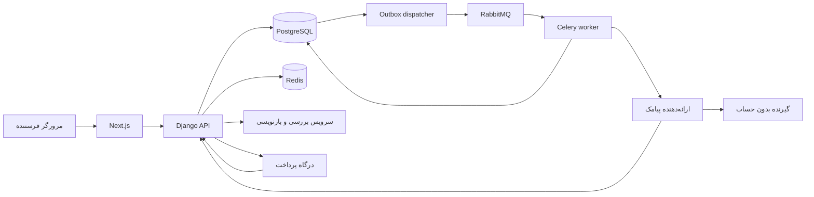

# معماری و تصمیم‌های فنی

این سند معماری هدف و ملاحظات پیاده‌سازی را توضیح می‌دهد. جزئیات رابط ارائه‌دهندگان و گزینه‌های تنظیمات باید با مستندات نسخه مورد استفاده تطبیق داده شوند. هر بخش که هنوز در کد وجود ندارد، الزام توسعه است.

## تصمیم ۱ — یک بک‌اند Django

برای شروع، Django به Go ترجیح داده شده است: مدل داده، مهاجرت، ورود و پنل مدیریت در یک برنامه جمع می‌شوند و تیم می‌تواند زودتر جریان محصول و رسیدگی به سوءاستفاده را آزمایش کند. منطق بیشتر کار، پایگاه داده و تماس با سرویس‌های بیرونی است؛ سرعت زبان به‌تنهایی مسئله فعلی را حل نمی‌کند.

انتخاب Go در صورت تخصص غالب تیم یا نیاز اندازه‌گیری‌شده ممکن است بازبینی شود. حدود ۱۰۰۰ حساب عمدتاً غیرفعال، دلیل ساخت میکروسرویس، چند زبان یا تقسیم پایگاه داده نیست. فعلاً یک monolith با worker جدا کافی است؛ این تصمیم تضمین ظرفیت نیست.

## اجزا و مسئولیت

| جزء | مسئولیت | داده‌ای که نباید منبع حقیقت آن باشد |
| --- | --- | --- |
| Next.js | فرم فارسی، پیش‌نمایش، نمایش قیمت و نتیجه، تجربه موبایل | تأیید پرداخت، مجوز ارسال و secretها |
| Django | احراز هویت، قواعد محصول، API، پنل مدیر و تراکنش‌ها | نتیجه صرفاً اعلام‌شده توسط مرورگر |
| PostgreSQL | کاربران، پیش‌نویس نهایی، قیمت ثبت‌شده، پرداخت، پیام، گزارش و outbox | حافظه موقت Redis |
| Redis | شمارنده محدودیت نرخ، cache و داده کوتاه‌عمر | وضعیت مالی، سوابق نهایی ارسال و لغو دریافت |
| RabbitMQ | رساندن کار به worker با امکان retry کنترل‌شده | دفتر مالی و وضعیت نهایی پیام |
| Celery worker | بازنویسی یا ارسال پس‌زمینه و تطبیق نتیجه طبق صف | تصمیم مستقل برای کسر وجه یا دورزدن محدودیت |
| ارائه‌دهندگان | OTP، پیامک، بازنویسی و پرداخت | تصمیم نهایی محصول بدون اعتبارسنجی پاسخ |

خرابی Redis نباید تاریخچه پرداخت یا لغو دریافت را حذف کند. برای کنترل‌های سوءاستفاده در دسترس‌نبودن شمارنده، ارسال باید متوقف یا از کنترل پایدار جایگزین استفاده شود؛ حذف کنترل با هدف سرعت مجاز نیست.

## مسیر داده هدف

مرورگر اعتبارنامه پرداخت، پیامک یا هوش مصنوعی دریافت نمی‌کند. payloadهای بازنویسی به شماره گیرنده نیاز ندارند؛ فقط حداقل متن لازم ارسال می‌شود.

## مدل دامنه پیشنهادی

- `Sender`: شماره تأییدشده، وضعیت دسترسی و زمان تأیید؛ رمز OTP در log ثبت نمی‌شود.
- `Draft`: متن ورودی و نسخه بررسی‌شده، تصمیم محتوا، نسخه قواعد و نسخه‌ای که کاربر تأیید کرده است.
- `Quote`: مبلغ، واحد، تعداد بخش پیامک و زمان اعتبار؛ قیمت از مرورگر پذیرفته نمی‌شود.
- `Payment`: شناسه داخلی، شناسه درگاه، وضعیت تأیید، برگشت و سوابق تغییر.
- `Message`: شماره مقصد محافظت‌شده، متن نهایی ثابت، وضعیت، شناسه ارائه‌دهنده و زمان‌ها.
- `OutboxEvent`: رویداد ارسال آماده‌شده در همان تراکنش پایگاه داده.
- `Suppression`: کلید شماره لغوشده و دامنه لغو دریافت؛ مستقل از وجود حساب گیرنده.
- `AbuseReport` و `AuditEvent`: گزارش، تصمیم مدیر و حداقل سابقه لازم.

این نام‌ها مفهومی‌اند و باید با مدل‌های واقعی کد تطبیق داده شوند. برای تمام شماره‌ها یک قالب استاندارد وجود دارد تا تفاوت شکل نوشتن، محدودیت‌ها را دور نزند.

## پرداخت و صف قابل اعتماد

1. مبلغ و نسخه متن در سرور ثبت می‌شود؛ پیش‌نویس پس از پرداخت بی‌صدا تغییر نمی‌کند.
2. callback پرداخت فقط محرک تأیید با ارائه‌دهنده است. وضعیت مرورگر یا پارامتر URL، تأیید پرداخت نیست.
3. تأیید پرداخت و ایجاد outbox در یک تراکنش PostgreSQL انجام می‌شود.
4. dispatcher رویدادهای ثبت‌شده را منتشر می‌کند؛ اگر پیش از تأیید انتشار متوقف شد، انتشار مجدد مجاز است.
5. worker با بررسی اتمیک وضعیت و شناسه یکتای عملیات، تکرار همان کار را تشخیص می‌دهد. محدودیت گیرنده و لغو دریافت دوباره بررسی می‌شوند.
6. نتیجه و شناسه ارائه‌دهنده ذخیره می‌شود. در خطای موقت، retry با تأخیر افزایشی و سقف تلاش انجام می‌شود؛ خطای دائمی به retry بی‌پایان نمی‌رود.

RabbitMQ و worker می‌توانند یک کار را بیش از یک بار تحویل دهند. «دقیقاً یک ارسال» صرفاً با صف تضمین نمی‌شود. اگر timeout پس از پذیرش پیامک رخ داد، نتیجه `unknown` است؛ ابتدا با شناسه عملیات یا استعلام ارائه‌دهنده تطبیق داده می‌شود و ارسال مجدد کورکورانه انجام نمی‌شود. اگر ارائه‌دهنده idempotency یا استعلام ندارد، این محدودیت باید قبل از انتشار در تصمیم ارائه‌دهنده لحاظ شود.

## وضعیت‌های موردنیاز

`draft → reviewed → awaiting_payment → paid → queued → submitting → provider_accepted → delivered`

شاخه‌های جدا: `rejected` برای محتوای نامجاز، `suppressed` به‌صورت داخلی برای لغو دریافت، `failed` برای شکست قطعی، `unknown` برای نتیجه نامشخص و `refund_pending / refunded` برای جریان مالی. پیام ممکن است در ارائه‌دهنده پذیرفته شود و هرگز تحویل نشود. callback دیررس نباید پیام ناموفق یا بازپرداخت‌شده را بدون قاعده روشن دوباره ارسال کند.

هر تغییر وضعیت باید انتقال مجاز و اتمیک داشته باشد. دکمه چندباره، callback تکراری و تحویل دوباره صف نباید پرداخت یا ارسال تازه بسازند. مدل محلی ممکن است تنها زیرمجموعه‌ای از این وضعیت‌ها را پوشش دهد.

## محیط محلی و عملیات

### تصمیم درباره WebSocket

نسخه فعلی هنگام در انتظار بودن سفارش، وضعیت همان سفارش را با HTTP polling بررسی می‌کند: شروع پس از ۱٫۵ ثانیه، سپس هر ۲ ثانیه تا سقف ۲۰ درخواست؛ بعد از نتیجه نهایی متوقف می‌شود و تازه‌سازی دستی هم وجود دارد. برای بار هدف فعلی و نبود چت، WebSocket اضافه نمی‌شود. این تصمیم بر اساس نیاز فعلی محصول است، نه ادعای نامناسب‌بودن WebSocket در همه مقیاس‌ها.

در صورت نیاز اندازه‌گیری‌شده به اعلان فوری وضعیت، ابتدا SSE بررسی می‌شود چون مسیر اعلان وضعیت یک‌طرفه است؛ WebSocket برای تعامل واقعاً دوطرفه قابل بررسی خواهد بود. در هر دو حالت مالکیت سفارش، انقضای نشست و جلوگیری از افشای داده گیرنده باید حفظ شوند. مرجع: [WebSocket API](https://developer.mozilla.org/en-US/docs/Web/API/WebSockets_API) و [Server-sent events](https://developer.mozilla.org/en-US/docs/Web/API/Server-sent_events/Using_server-sent_events). WebSocket شیوه رسیدن پیامک به گوشی گیرنده را تغییر نمی‌دهد.

Compose برای بازتولید محیط توسعه است. portهای پایگاه داده، Redis و RabbitMQ در انتشار عمومی قرار نمی‌گیرند. secret واقعی در Git، image یا frontend قرار نمی‌گیرد و کلیدهای نمونه در production پذیرفته نمی‌شوند.

CI باید آزمون‌ها، build، بررسی پیکربندی Compose و مهاجرت‌های مرتبط را انجام دهد. CD فعلی می‌تواند تنها image یا محیط تست محلی آماده کند؛ استقرار اینترنتی و مقصد production تصمیم بعدی است. نسخه‌های dependency و image باید قابل بازتولید باشند.

پیش از انتشار: پشتیبان و بازیابی عملی PostgreSQL، سن صف، نرخ خطا، تعداد retry، وضعیت outbox، هزینه روزانه و هشدار خرابی ارائه‌دهنده بررسی می‌شوند. logها شماره کامل، OTP، متن خصوصی یا پاسخ خام درگاه را بی‌دلیل نگه نمی‌دارند. شاخص‌ها با شناسه داخلی قابل پیگیری می‌شوند.
