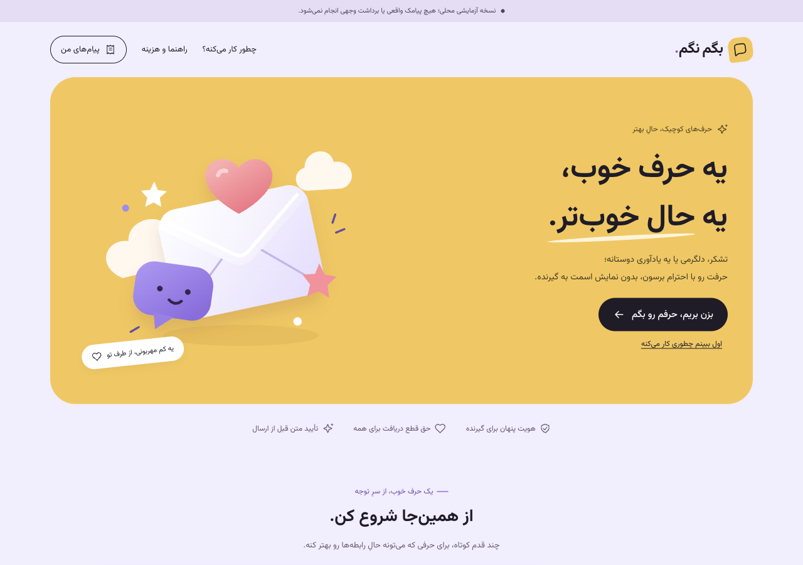

# تحویل پیاده‌سازی فاز یک — بگم نگم

تاریخ: ۲۴ اکتبر ۲۰۲۶ | مبنا: خروجی فاز صفر نسخه۱٫۰ و دستور جدید کارفرما برای شروع پیاده‌سازی و ظاهر پیوست

**وضعیت: پیاده‌سازی پایه محلی برای بررسی؛ پذیرش کامل G1 هنوز بسته نشده است.**

مجوز جدید به‌عنوان اجازه اجرای پایه محلی فاز یک و جهت بصری ثبت شد؛ تصمیم‌های تجاری/اتصال واقعیِ باز، مصوب فرض نشدند. بسته‌های پروپوزال و فاز صفر برای تاریخچه تغییر نکرده‌اند. مجوز فاز دو، ارسال/پرداخت واقعی، خرید، پایلوت یا انتشار وجود ندارد.

## خروجی قابل مشاهده

نسخه محلی: [localhost:3000](http://localhost:3000). ظاهر فارسی Mobile-first با زمینه یاسی، کارت زرد، بنفش/مرجانی، فرم‌های سفید و گرد، دکمه‌های مشکی و منوی پایین موبایل. تصویرسازی نامه/حباب پیام SVG اختصاصی است؛ تصویر مرجع مستقیماً کپی یا به‌عنوان دستور متنی استفاده نشده. جهت بصری در design-system/begamnagam/MASTER.md ثبت است.




## کار انجام‌شده

- پوسته، معرفی، فرم‌ها، صفحات راهنما/سابقه/ترجیحات و منوی موبایل با زبان بصری جدید؛ حفظ عملکرد آزمایشی موجود، RTL، فونت محلی، focus و reduced-motion.
- manifest دارای id پایدار، PNG192/512، maskable و آیکون Apple؛ theme و safe-area هماهنگ.
- پایه SW در build production: precache فقط چهار فایل عمومیِ offline/icons؛ هیچ API، نشست، RSC، شماره، متن، سابقه یا درخواست مالی کش یا replay نمی‌شود. navigation آنلاین network-only؛ قطع شبکه به fallback ناشناس می‌رود. update خودکار صفحه را reload نمی‌کند؛ waiting worker طبق چرخه عادی منتظر می‌ماند.
- schema مستقل PaymentAttempt، MessageDelivery، Refund و FinancialEvent با migration افزایشی0002؛ قیود مبلغ مثبت/تومان، شناسه بیرونی یکتا، یک پرداخت تخصیص‌یافته به سفارش، رابطه رویداد refund و محدودیت demo در دیتابیس.
- قراردادهای pure آداپتور demo/disabled، بدون SDK یا تماس شبکه؛ guard تنظیمات از نام backend ناشناخته جلوگیری می‌کند.
- نمایش فقط‌خواندنی مدل‌های جدید در admin؛ نقش‌های inspection بدون انتساب به هیچ کاربر، و فرمان check_foundation برای بررسی PostgreSQL/migration/Redis/RabbitMQ و حالت demo.
- نسخه Node24/Python3.13 مشخص، lockfile حفظ، فرمان verify-foundation و بررسی‌های متناظر CI اضافه شده‌اند. CI روی GitHub اجرا/منتشر نشده است.

پیش از migration محلی از PostgreSQL نسخه پشتیبان خصوصی در `.local/pre-phase-one.dump` گرفته شد؛ این فایل شامل داده است و وارد تحویل/مخزن نمی‌شود. migration افزایشی اعمال شد؛ داده موجود حذف نشد. برای دیدن نسخه تازه فقط پردازش‌های متعلق به همین پروژه دوباره اجرا شدند؛ سرویس‌های پروژه‌های دیگر تغییر نکردند.

## مرز پایه با فازهای بعد

مدل‌های مالی/ارسال جدید **هنوز به checkout قدیمی demo متصل نشده‌اند**؛ مسیر قبلی Order/Outbox حفظ شده تا بازطراحی quote و workflow در فاز مجاز بعد انجام شود. وجود schema یا pure adapter به معنی ledger کامل، بازپرداخت عملیاتی، تطبیق provider یا تحویل واقعی نیست. کنترل جمع refund، انطباق مبلغ/مالکیت روابط، گذار وضعیت و ثبت اتمی رویداد باید در لایه سرویس و آزمون فاز مربوط تکمیل شود.

پایه PWA فعال است، اما PWA کاملِ پذیرفته‌شده ادعا نمی‌شود: راهنمای نصب/اعلان update، آزمون دو تب/rollback/Back و حساب مشترک، و نصب واقعی Android/iOS هنوز دروازه‌های بعدی‌اند. آزمون مرورگر رومیزی با عرض موبایل جای گوشی واقعی نیست. ورود بی‌حساب به stop/report، جفت۳۰روزه، quote شامل لینک نهایی و providerهای واقعی نیز به فازهای بعد تعلق دارند.

## شواهد آزمون این نوبت

| بررسی | نتیجه |
| --- | --- |
| بک‌اند روی PostgreSQL17/Redis | ۴۰ تست PASS، بدون skip؛ شامل۸ آزمون جدید قیود/adapter؛ با cryptography46.0.7 تکرار شد |
| فرانت | ۱۰ تست PASS؛ سه تست جدید مرزهای SW/cache/offline |
| TypeScript و build تولیدی Next.js | PASS |
| migration consistency / Django check | PASS؛ migration0002 روی DB محلی اعمال و readiness موفق |
| demo end-to-end از پروکسی Next.js | PASS؛ OTP، CSRF، preview، idempotent checkout، پرداخت نمونه، worker، history، opt-out و ownership |
| بررسی manifest/آیکون‌ها/هدر SW | PASS؛ scripts/verify-foundation.py، ابعاد واقعی PNG و no-store API/worker |
| عرض‌ها | ۳۲۰،۳۶۰،۳۷۵،۳۹۰،۴۱۲،۷۶۸ و۱۲۸۰؛ scrollWidth با innerWidth برابر، بدون overflow افقی |
| کش در مرورگر واقعی دسکتاپ | چهار URL عمومی فقط؛ SW کنترل‌کننده فعال؛ API/private data در CacheStorage دیده نشد |
| قطع واقعی سرور محلی | درخواست مسیر خصوصی به صفحه عمومی «یه مکث کوچیک» رسید؛ سرور سپس دوباره اجرا شد |
| build کامل Compose | FAIL/BLOCKED؛ backend pip در دریافت/resolve cryptography46.0.7 با No matching distribution متوقف شد؛ build image فرانت موفق، اما کل stack روی محیط پاک تأیید نشده |
| RabbitMQ | broker محلی قبلی4.2.9؛ فایل اصلی4.4 است؛ اجرای نسخه فعلی4.4 تأیید نشده |
| گوشی واقعی / WCAG کامل / ظرفیت هدف / live provider | NOT TESTED |

دانلود مستقیم wheel رسمی macOS با SHA-256 اعلام‌شده PyPI تطبیق و نسخه دقیق cryptography46.0.7 در venv پروژه نصب شد؛ تست بک‌اند با همین نسخه موفق بود. این کار مشکل build لینوکسی Docker را حل‌شده نشان نمی‌دهد. dependencyها به نسخه قدیمی‌تر کاهش داده نشدند و هیچ TLS/امنیتی برای دانلود خاموش نشد.

## مانع پذیرش کامل و توقف

پیش از بستن G1 باید build کامل فایل اصلی Compose و راه‌اندازی روی محیط پاک، با نسخه‌های قفل‌شده به‌ویژه RabbitMQ4.4، موفق و مستند شود. در این محیط آن مدرک هنوز موجود نیست؛ خروجی فعلی برای بازبینی UI و کد آماده است، نه پذیرش کامل G1 یا آمادگی انتشار.

پس از رفع مانع و تأیید تحویل، شروع فاز دو مجوز مستقل لازم دارد. اکنون توسعه به فاز بعد ادامه داده نشده و هیچ پیامک/پرداخت/هزینه واقعی ایجاد نشده است.

## اجرای بررسی‌ها

در محیط Compose کامل، پس از نصب dependencyها و migrate:

```sh
make test
make smoke
make foundation-check
```

فرمان backend جدید: `python manage.py check_foundation`. نقش‌های بدون انتساب: `python manage.py bootstrap_roles`. فرمان‌ها در README اصلی برای محیط محلی توصیف شده‌اند. اسرار از `.env` خصوصی خوانده می‌شوند و در گزارش یا log نمایش داده نمی‌شوند.

## منابع فنی

Context7 برای Next.js و Django resolve شد اما quota ماهانه تمام بود؛ به API ساختگی استناد نشد. از [راهنمای رسمی Next PWA](https://nextjs.org/docs/app/guides/progressive-web-apps)، [قیود Django5.2](https://docs.djangoproject.com/en/5.2/ref/models/constraints/)، [migration Django](https://docs.djangoproject.com/en/5.2/topics/migrations/) و [فایل رسمی cryptography در PyPI](https://pypi.org/project/cryptography/46.0.7/) استفاده شد.
