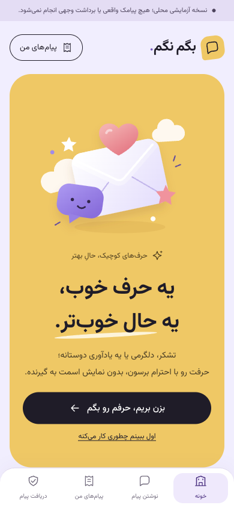
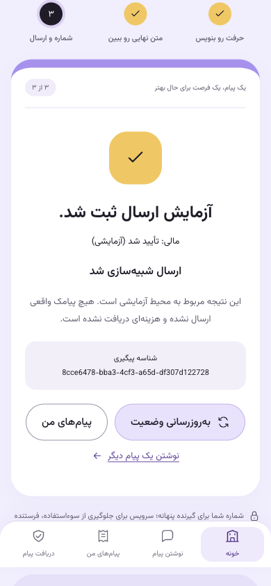

# نسخه ۰٫۳٫۱ — خروجی فازهای صفر تا دو

مجوز جاری: اجرای کامل فازهای۰،۱،۲، بدون سؤال مجدد، فقط commit محلی و بدون push. متن و حدود مجوز در AUTHORIZATION.json ثبت شده‌اند. بسته‌های فاز صفر و یک تاریخچه‌اند؛ تصمیم‌های تجاری ارائه‌دهندگان، قیمت فروش، ارسال و پرداخت واقعی همچنان به فازهای بعد تعلق دارند.

## پیاده‌سازی تحویل‌شده

- اسناد PRD، معماری Django/Next.js، مدل AI محدود به قالب، Freeze Master و ماتریس ۵۶ نیازمندی فاز صفر حفظ شده‌اند. مبنای جاری توسعه محلی همین بسته و جهت بصری مصوب است؛ امضای کارفرما برای تصمیم‌های تجاری آینده جعل نشده است.
- corpus ثابت۱۲۰ ورودی مصنوعی فارسی/انگلیسی شامل هفت موضوع مجاز، تزریق دستور، اطلاعات تماس و توهین پنهان‌شده اضافه شد. کشیدهٔ عربی پیش از فیلتر حذف می‌شود؛ هیچ ادعای تشخیص کامل زبان یا ایمنی مدل زنده نداریم.
- UI موبایل فان و RTL با رنگ‌های زرد/یاسی/بنفش/مرجانی، فونت محلی، ورودی موبایل، focus و reduced motion حفظ شده است.
- پیش‌نمایش مخصوص گیرنده پس از تأیید شماره فرستنده، متن کامل همراه برند و URL توقف، قیمت صحیح تومان، تعداد بخش حداکثر۳ و انقضای۱۵دقیقه را ثبت می‌کند. عوض‌کردن گیرنده پس از پیش‌نمایش در سرور رد می‌شود. قالب‌های مثبت و حساس همان کنترل‌ها را دارند.
- سفارش و پرداخت تکرارپذیرند. پرداخت demo، رویداد مالی، رکورد ارسال و outbox در تراکنش ثبت می‌شوند. worker موفقیت یا توقف/شکست را جدا از مالی ثبت می‌کند؛ شکست نهایی پرداخت‌شده یک refund آزمایشی و یک رویداد استرداد می‌سازد.
- سقف سه سفارش فرستنده، یک رزرو فعال گیرنده و فاصله۷روزه پس از تحویل و یک ارسال برای جفت در۳۰روز از PostgreSQL دفاع می‌شوند. cooldown موفق در زمان تحویل شبیه‌سازی ثبت می‌شود؛ پاک‌شدن Redis محدودیت جفت را حذف نمی‌کند.
- migration افزایشی0003 متن کامل و گیرنده پیش‌نمایش را اضافه و0004 سوابق demo قدیمیِ پرداخت‌شده را به مدل‌های مستقل مالی/ارسال منتقل می‌کند. داده مالی موجود حذف نمی‌شود.
- PWA شامل manifest، آیکون‌های PNG/Apple/maskable، ثبت worker، آفلاین عمومی، راهنمای نصب iOS و prompt واقعی مرورگرهای پشتیبان است. API/RSC/اطلاعات خصوصی کش یا صف آفلاین نمی‌شوند.
- نسخه تازه waiting می‌ماند؛ activation/reload فقط با اقدام صریح در نقطه امن انجام می‌شود. فرم دارای متن، گیرنده، OTP یا سفارش باز مانع update است. logout و بازگشت bfcache حافظه خصوصی را پاک می‌کنند؛ پاسخ دیررس bootstrap قبلی دوباره حساب قدیمی را فعال نمی‌کند.

## آزمون‌های انجام‌شده

| مورد | شاهد |
| --- | --- |
| PostgreSQL17 + Redis | ۴۶ تست موفق، بدون skip؛ شامل corpus ثابت۱۲۰ ورودی، schema، idempotency، refund تکرارناپذیر، quote و سقف جفت |
| فرانت | ۱۰ تست موفق؛ API، ارقام/شماره‌ها و مرزهای SW/private-cache/offline |
| TypeScript و build تولیدی | موفق |
| migration consistency و readiness | موفق؛ PostgreSQL/Redis/RabbitMQ، حالت template/demo |
| مسیر کامل API از Next.js و worker مستقل | موفق؛ OTP/CSRF/preview/order/pay-demo/history/preferences/ownership |
| مرورگر واقعی دسکتاپ با viewport موبایل | ورود demo، قالب قدردانی، quote سه‌بخشی، سفارش، پرداخت و رسید با مالی/ارسال جدا موفق؛ nested form و خطای JavaScript مشاهده نشد |
| قطع و بازیابی واقعی صف | RabbitMQ/worker/beat متوقف شدند؛ پرداخت و outbox حفظ شد؛ پس از راه‌اندازی همان سفارش تحویل demo و retry بدون برداشت دوم بود؛ شمارش دیتابیس برای همه سفارش‌های پرداخت‌شده محیط پاک فقط یک capture و یک attempt ارسال را نشان داد |
| update امن در مرورگر | وسط سفارش رد شد؛ بعد پاک‌کردن فرم با اقدام صریح کاربر فعال و صفحه دوباره باز شد |
| خروج در مرورگر | سابقه و شماره پوشیده از UI حذف و فرم ورود نمایش داده شد |

نسخه دقیق cryptography46.0.7 در آزمون native استفاده شد. فایل‌های wheel در صورت نیاز با SHA-256 رسمی بررسی می‌شوند، وارد Git نمی‌شوند و TLS یا pin نسخه‌ها برای دورزدن شبکه ضعیف نشده است. وضعیت ساخت/اجرای محیط پاک در INFRASTRUCTURE.md جدا ثبت می‌شود؛ موفقیت native جای آن مدرک نیست.

## موارد خارج از ادعای پذیرش

نصب روی گوشی فیزیکی Android/iOS، VoiceOver/TalkBack، ارزیابی کامل WCAG2.2AA، update دو تب با نسخه‌های قدیمی و rollback روی دستگاه واقعی در این محیط ابزار ندارند و PASS فرض نشده‌اند. برای پذیرش رسمی G2، تست دستگاه واقعی طبق ماتریس فاز صفر هنوز لازم است. پیاده‌سازی نرم‌افزاری و شبیه‌سازی مرورگر جای آن شواهد را نمی‌گیرد.

مسیر بی‌حساب stop/report با لینک اختصاصی، سیاست کامل retention، بررسی حقوقی/قراردادی، providerهای واقعی، بازپرداخت بانکی و بار هدف انتشار موضوع فازهای۳تا۶ هستند؛ URL فعلی قطع دریافت در demo به صفحه تأیید شماره خود گیرنده می‌رود. هیچ ارتباط مستقیم بین طرفین یا ارسال گروهی ایجاد نشده است.

## نسخه‌بندی و تحویل

نسخه قبلی۰٫۲٫۰ به‌عنوان اولین snapshot مخزن در commit4a327a1 ثبت شد. نسخه۰٫۳٫۰ تغییرهای محصول و تست‌های این گزارش است. اصلاح‌های زیرساختی بعدی با patch مستقل ثبت می‌شوند. هیچ push یا استقرار بیرونی انجام نمی‌شود. وضعیت Git و hash کامیت نهایی در گزارش تحویل اعلام می‌شود.

## نتیجه تکمیلی زیرساخت — نسخه۰٫۳٫۱

مانع Docker فاز یک با کش wheel رسمی بررسی‌شده رفع شد. imageهای کامل ساخته شدند و محیط جدا با دیتابیس تازه و RabbitMQ4.4 سالم بالا آمد. ۴۶ تست بک‌اند داخل کانتینر نیز بدون skip موفق شدند؛ گزارش مستقل [INFRASTRUCTURE.md](INFRASTRUCTURE.md) روش و محدودیت‌ها را ثبت می‌کند. قفل کامل وابستگی‌ها در Docker و CI استفاده می‌شود. ناسازگاری صف موقت Celery با RabbitMQ4.4 با تنظیم exclusive اصلاح شد و مسیر ارسال در محیط تازه موفق بود. پذیرش نصب روی دستگاه فیزیکی G2 همچنان باز است.
