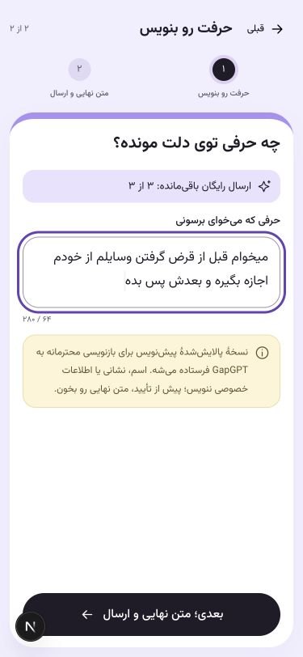
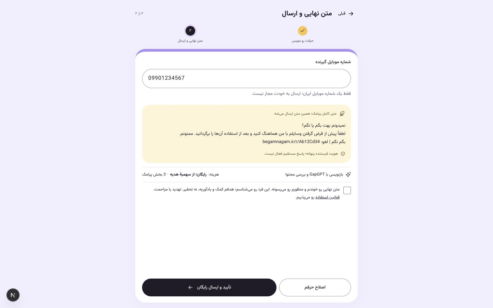

# نسخه۰٫۱۰٫۰ — اتصال آمادهٔ GapGPT و نوشتن آزاد

کارفرما خواست موضوع‌ها پیشنهاد باشند و متن دلخواه، پس از پالایش محلی فحش، با حفظ منظور مؤدبانه شود؛ سپس صریحاً خواست کلید در env فعلاً خالی بماند. این انتشار اتصال را آماده می‌کند: کلید و مدل خالی، سقف‌های AI صفر و حالت واقعی template باقی می‌مانند. اتصال واقعی و کیفیت فارسی مدل هنوز آزموده نشده‌اند؛ هیچ تماس پولی AI برای این نسخه انجام نمی‌شود.

در حالت تنظیم‌شده، category خالی یا hint است و موضوع بر متن تحمیل نمی‌شود. ویرایش مثال، hint قبلی را پاک می‌کند. متن کامل پیامک و تأیید حفظ منظور پیش از ارسال هستند. حالت غیرفعال صریح است؛ درخواست تازهٔ freeform یا مثال ویرایش‌شده در حالت suggestion به قالب نامرتبط تبدیل نمی‌شود. کلاینت قدیمی بدون source_mode در حالت قالب برای سازگاری حفظ شده است.

فحش شناخته‌شده پیش از API حذف می‌شود؛ فحشِ بدون منظور سازنده، تهدید/نفرت/اتهام حساس، دادهٔ تماس و دستور دورزدن رد می‌شوند. دو درخواست مستقل، تولید و سپس بررسی ادب/حفظ منظور/نبود ادعای افزوده و دادهٔ خصوصی را انجام می‌دهند؛ guard محلی خروجی را دوباره بررسی می‌کند. فیلتر واژگانی کامل نیست و بررسی واقعی مدل و تأیید فرستنده همچنان لازم‌اند. خروجی بلند بریده یا با قالبی دیگر جایگزین نمی‌شود.

فقط پیش‌نویس پالایش‌شده به مدل می‌رود؛ تلفن، گیرنده، حساب و نشست داده نمی‌شوند. raw draft ذخیره یا log نمی‌شود. بدنهٔ پذیرفته‌شده رمز و به preview/owner/recipient/price/terms/expiry امضا می‌شود؛ checkout و هر دو adapter همان snapshot را بررسی می‌کنند و worker دوباره AI را صدا نمی‌زند. سقف مستقل DB روزانه و هر حساب، حداکثر۲تماس و۳۲۰توکن خروجی برای هرکدام، timeout محدود، نبود retry/redirect/proxy و endpoint رسمی ثابت برقرارند. سقف‌های اولیه۰هستند؛ بودجهٔ پیامک و هدیه‌ها تغییر نمی‌کنند.

Migration۰۰۱۵ فیلدهای optional پیش‌نمایش و جدول‌های شمارش را اضافه می‌کند و دادهٔ قدیمی را reset نمی‌کند. retention/rotation بدنهٔ تولیدشده را پوشش می‌دهند؛ پنل گزارش بدنهٔ AI و دعوت را بدون افشای capability نشان می‌دهد. rollback با schema افزوده و بدون بازپخش سفارش custom انجام شود.

متغیرهای لازم: `GAPGPT_API_KEY`، `GAPGPT_MODEL`، `GAPGPT_BASE_URL=https://api.gapgpt.app/v1`، `GAPGPT_TIMEOUT_SECONDS=5`، `GAPGPT_DAILY_REQUEST_LIMIT=0`، `GAPGPT_USER_DAILY_LIMIT=0`. برای فعال‌سازی بعدی، مدل و سقف مثبت مصوب و `AI_MODE=gapgpt` نیز لازم‌اند؛ کلید خالی هیچ شبکه‌ای ایجاد نمی‌کند. قیمت به مدل و توکن ورودی هم وابسته است و سقف تعداد، جای تعرفه/سقف مبلغ قراردادی نیست. کلید API مستقل از اشتراک چت است. [مرجع رسمی GapGPT](https://gapgpt.app/platform-v2/docs/quickstart) بررسی شد؛ Context7 این نشست ابزار قابل‌فراخوانی نداشت.

## بررسی

۲۵۲آزمون PostgreSQL/Redis و۳۱آزمون فرانت، typecheck و build انتشار موفق‌اند. ۴۵آزمون تازه، client، guard، استقلال متن از موضوع، سهمیهٔ پایدار و هم‌زمانی، امضا/گیرنده، خطای Unicode، ارسال دقیق و گزارش را پوشش می‌دهند. آزمون‌ها پاسخ ساختگی دارند؛ پیامک واقعی یا تماس پولی AI برای این نسخه ارسال نمی‌شود. فرم در۳۷۵و۱۴۴۰پیکسل با bootstrap فعال ساختگی، بدون هیچ موضوع و با متن دلخواه تا پیش‌نمایش بررسی شد؛ category خالی، source_mode=freeform و بدون سرریز افقی بود. حالت غیرفعال و پیشنهاد آماده نیز کار کردند. mock، viewport و تب پس از کار پاک شدند. تصاویر نمونهٔ قابلیت آماده‌شده‌اند، نه ادعای اتصال حساب واقعی.

نسخه۰٫۱۰٫۰ روی CT فعال و هر۸سرویس سالم‌اند؛ هر۳سرویس داده بدون recreate حفظ شدند. migration پس از dump رمز‌شده اجرا شد؛ ماندهٔ هدیه و بودجهٔ SMS/OTP تغییر نکردند. 35بررسی HTTPS از IP لبه با TLS معتبر موفق‌اند؛ مسیر عادی اینترنتی این نشست بررسی نشده است. کلید/مدل GapGPT خالی، سقف‌های آن صفر و bootstrap روی template تأیید شدند. [شواهد استقرار](../deployments/ct115-0.10.0.json) جزئیات را دارد.
