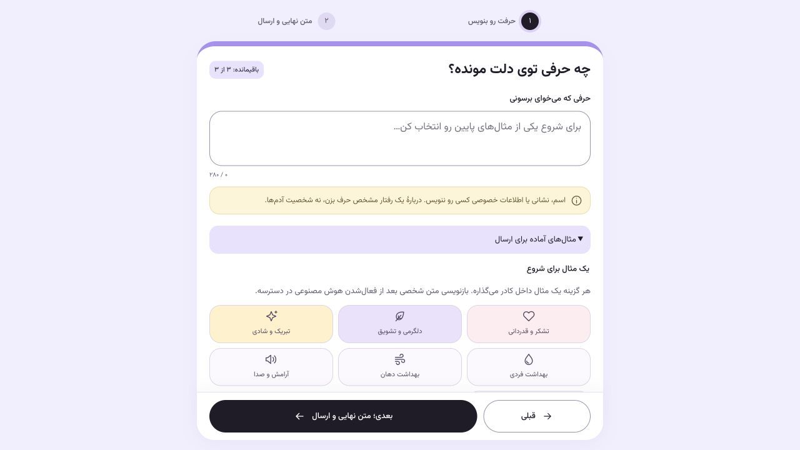
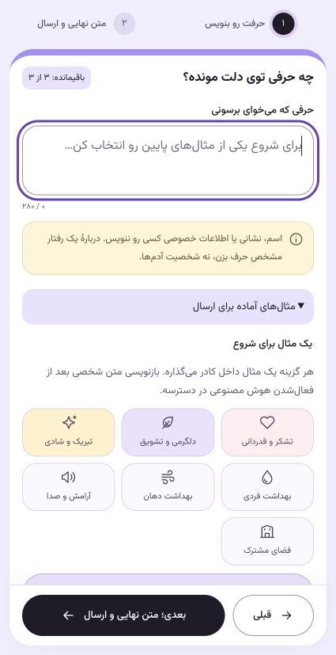

# نسخه۰٫۱۰٫۲ — انتشار فرم جمع‌وجور روی محصول واقعی

این انتشار پس از دستور صریح کارفرما برای ارسال تغییرات رابط روی سرور انجام شد. تصویر frontend۰٫۱۰٫۲ فعال است؛ backend/worker/beat۰٫۱۰٫۱، proxy و هر۳سرویس داده با همان شناسهٔ کانتینر حفظ شدند. هیچ migration، بازنشانی هدیه/دفتر هزینه یا توقف ارسال لازم نبود.

هفت اصلاح مرورگر شامل حذف توضیح OTP واقعی، حذف toolbar بالایی، ردیف ثابت پایین با قبلی کوچک و outlined، اعداد کنار مراحل، ماندهٔ کوتاه کنار عنوان، حذف کادر بازنویسی غیرفعال و راهنمای شمارهٔ گیرنده، و پنجرهٔ قوانین است. عنوان صفحه برای صفحه‌خوان حفظ شده و پنجرهٔ قوانین متن مشترک با صفحهٔ حریم خصوصی دارد؛ بازکردن آن تأیید ارسال محسوب نمی‌شود. [گزارش بررسی ظاهری](../ui-composer-compact/README.fa.md) جزئیات موبایل و رفتار پنجره را دارد.

۳۱آزمون فرانت و TypeScript/build موفق‌اند. ۳۶بررسی HTTPS با تأیید TLS، تطبیق hash هر۱۰فایل JS/CSS فعلی با خروجی build و بررسی HTML نسخه۰٫۱۰٫۲ موفق بود. ۷۹فایل static قدیمی در تصویر جدید نیز موجودند تا تب‌های باز، chunkهای لازم را از دست ندهند. Service Worker تغییری نکرده است؛ HTML را از شبکه می‌گیرد و API/RSC را کش نمی‌کند.

تب تازهٔ محصول واقعی در مرورگر باز و toolbar حذف‌شده، ردیف ثابت و ماندهٔ کنار عنوان تأیید شدند؛ فرم باز قبلی کاربر reload نشد. هر۸سرویس سالم‌اند؛ OTP و پیام گیرنده/دعوت با کاوه‌نگار واقعی، ارسال باز، سقف روزانهٔ سراسری غیرفعال و پرداخت پولی بسته‌اند. کلید GapGPT طبق درخواست قبلی همچنان خالی است. هیچ درخواست OTP، پیامک واقعی یا ارسال شبیه‌سازی‌شده برای تأیید انتشار انجام نشد.

[شواهد استقرار](../deployments/ct115-0.10.2.json) تصویر، وضعیت سرویس‌ها و checksumها را دارد. بازگشت در صورت نیاز فقط با اجرای سرویس frontend از `/opt/begamnagam/releases/0.10.1` و env همان پوشه، سپس بازگرداندن اتمیک پیوند current پس از تأیید سلامت انجام می‌شود؛ بک‌اند و صف‌ها نباید بازسازی یا بازپخش شوند. تصویر frontend۰٫۱۰٫۰ و انتشار قبلی برای این کار حفظ شده‌اند.

Context7 ابزار قابل‌فراخوانی نداشت؛ راهنمای رسمی نصب‌شدهٔ Next.js و [Self-hosting](https://nextjs.org/docs/app/guides/self-hosting) و [Compose up](https://docs.docker.com/reference/cli/docker/compose/up/) بررسی شدند. بسته با مبدأ HTTPS دامنه و API داخلی صحیح ساخته شد؛ وابستگی‌های Next/React و کتابخانه‌های native لینوکس از تصویر قبلی با همان نسخه‌ها حفظ شدند.

## بررسی دوبارهٔ محصول واقعی

به درخواست کارفرما، مراحل بدون گیرنده دوباره بررسی شدند. در عرض‌های۳۷۵،۴۷۸و۱۴۴۰، ردیف ثابت، عرض کمتر قبلی، مراحل خطی و ماندهٔ کنار عنوان درست‌اند و سرریز افقی وجود ندارد. شمارهٔ ناقص در خود فرم رد شد و خطا بالاتر از ردیف دکمه‌ها ماند؛ بازگشت، متن و انتخاب پیشنهاد را حفظ کرد. ۳۶بررسی HTTPS دوباره موفق بودند و پیکربندی OTP/پیام واقعی، ارسال باز و خاموش‌بودن demo روی سرور دوباره تأیید شد.

طبق انتخاب کارفرما، گیرندهٔ واقعی وارد نشد و پیش‌نمایش نهایی/پنجرهٔ قوانین در این نوبت بررسی نشدند. هیچ OTP، سفارش یا پیامکی درخواست نشد. متن و انتخابِ ساخته‌شده برای بررسی پاک و اندازهٔ مرورگر به حالت اولیه برگشت؛ گزارش این نوبت صرفاً محلی ثبت شده است.

