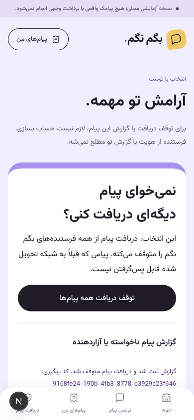

# نسخه۰٫۵٫۰ — ایمنی و عملیات فاز۴

این تحویل، پیاده‌سازی و آزمون محلی است. تأیید انسانی/ارائه‌دهنده واقعی یا اجازه انتشار عمومی را جعل نمی‌کند. مجوز ادامه تا فاز۶ و تعویق تست‌های انسانی در بسته۰٫۴ ثبت است.

## رفتار محصول

لینک `/r#…` از۲۵۶بیت تصادف ساخته می‌شود؛ fragment به سرور/access log نمی‌رود. API توکن را در JSON با CSRF می‌گیرد؛ GET اسکنر بی‌اثر است. لینک فقط بعد پذیرش ارسال/تحویل demo فعال می‌شود، گزارش۳۰روز و توقف۳۶۵روز اعتبار دارد. پاسخ شامل شماره، فرستنده، سفارش یا متن نیست. گزارش تکراری یک پرونده و کد پیگیری می‌سازد و دریافت را سراسری متوقف می‌کند؛ گزارش بی‌حساب، فرستنده را خودکار تنبیه نمی‌کند. بازفعال‌سازی به OTP تازه حداکثر۵دقیقه‌ای برای شماره خود مالک نیاز دارد.

فقط digest توکن در grant ذخیره می‌شود؛ نسخه کامل پیام که خود لینک را دارد، جدا در دیتابیس رمز می‌شود. توضیح گزارش نیز رمز می‌شود. ورودی خام دائمی نیست. snapshotهای قدیمی با migration افزایشی رمز شده‌اند؛ بازگشت کد به قبل۰٫۵ با این داده سازگار نیست و floor بازگشت در راهنمای انتشار ثبت می‌شود.

درخواست حذف حساب با تأیید تازه، ارسال جدید را می‌بندد؛ شماره قابل‌بازیابی بعد۳۰روز حذف می‌شود. متن/لینک/شماره سفارش نتیجه‌دار بعد۳۱روز پاک می‌شود تا سقف جفت۳۰روزه ضعیف نشود. suppression و سوابق حداقلی مالی حذف نمی‌شوند. پرونده با hold قابل تمدید فقط۳۰روزه نگه داشته می‌شود؛ متن گزارش تا۱۸۰روز نگه داشته می‌شود و پس از مهلت پاک می‌شود. حل‌نشده‌های عملیاتی به جای پاک‌شدن کور، برای رسیدگی باقی می‌مانند.

## عملیات

- نقش‌های content_support، finance_operator و safety_operator ایجاد می‌شوند، اما به هیچ شخصی انتساب داده نشده‌اند. مشاهده پرونده و تغییرهای حساس ممیزی می‌شوند. پنل مالی متن پیام/توکن/شماره کامل را نشان نمی‌دهد.
- توقف سراسری، سفارش جدید/ارسال را می‌بندد و صف موجود را بدون ساخت رویداد تازه به تعویق می‌اندازد؛ تطبیق مالی متوقف نمی‌شود. تعلیق حساب، توقف گیرنده و تاریخ حذف، دوباره پیش از submission کنترل می‌شوند.
- ساعات ارسال خارجی پیش‌فرض۹تا۲۱ تهران است. پایلوت خارجی پیش‌فرض فقط موضوع‌های مثبت است. demo برای آزمون همه هفت موضوع باز می‌ماند.
- بودجه ناخالص به refund وابسته نیست؛ هزینه مشاهده‌شده بالاتر از سقف رزرو، ثبت می‌شود و خرج تازه/ارسال را متوقف و هشدار بحرانی می‌سازد. اندازه هزینه باید قبل فعال‌سازی از قرارداد تأیید شود.
- شاخص‌های صف، پرداخت/ارسال نامعلوم، refund باز، گزارش باز و بودجه از `ops_snapshot` و API دارای مجوز خوانده می‌شوند. log دسترسی production شامل شماره، متن، query یا token نیست.
- خروج یا تغییر حساب، با BroadcastChannel و بررسی دوباره هنگام focus حافظه خصوصی تب‌های دیگر را پاک می‌کند. update PWA قبل activation از همه تب‌ها تأیید خالی‌بودن فرم می‌گیرد؛ تب کثیف یا بدون پاسخ مانع update می‌شود و reload اجباری ندارد.

## شواهد

۷۹ تست بک‌اند روی PostgreSQL/Redis بدون skip،۱۳ تست فرانت و typecheck موفق‌اند. موارد شامل CSRF/اسکنر، لینک نامعتبر/منقضی، عدم افشای طرفین، گزارش تکراری، OTP تازه، تعلیق/مجوز/ممیزی، توقف و ازسرگیری همان صف، quiet hours، حذف/hold، چرخش کلید، هزینه بیش از سقف و refund مستند هستند. تست مرورگر نیز گزارش مصنوعی و توقف بدون ورود را تأیید کرد.



پشتیبان رمز‌شده روی دیتابیس جدید بازیابی شد: صفر مغایرت مالی، صفر اختلاف suppression،۵۶ فیلد رمز‌شده معتبر و ارسال متوقف. زمان restore حدود۳ثانیه بود؛ این عدد SLA یا RTO محیط واقعی نیست. [جزئیات](RESTORE.json). فایل/کلید پشتیبان خصوصی در `.local` هستند و وارد Git نشده‌اند.

## تکرار عملیات

```sh
# داخل محیط بک‌اند با PostgreSQL و Redis تنظیم‌شده
python manage.py bootstrap_roles
python manage.py ops_snapshot
python manage.py prune_private_data --dry-run
python manage.py prune_private_data
# ابتدا active key جدید و fallback قبلی را امن تنظیم کنید؛ HMAC را تغییر ندهید
python manage.py rotate_encryption
python manage.py rotate_encryption --apply
```

```sh
backend/.venv/bin/python scripts/backup-restore.py init-key --key-file .local/backup.key
backend/.venv/bin/python scripts/backup-restore.py backup --key-file .local/backup.key --archive .local/backup.bng
backend/.venv/bin/python scripts/backup-restore.py restore --key-file .local/backup.key --archive .local/backup.bng --target-db begamnagam_restore_review
```

Restore فقط دیتابیس جدید با پیشوند کنترل‌شده می‌سازد؛ overwrite/drop منبع ندارد. آخرین suppression، درخواست حذف و بودجه از منبع در دسترس بازاعمال می‌شود. نبود رویداد مالی پس از snapshot، readiness را رد می‌کند. intentهای خارجی بازیابی‌شده فقط استعلام می‌شوند؛ resume خودکار ممنوع است. کلید application و backup جدا و خارج مخزن نگه داشته شوند. آرشیو اولیه حداکثر۲۵۶MiB است؛ برای رشد، پشتیبان streaming/WAL و محل خارج دستگاه لازم است.

## موارد نگه‌داشته‌شده

بازبینی انسانی محتوا/حقوقی/حریم خصوصی، انتساب مسئول و کانال پشتیبانی، تست گوشی/خوانش صفحه و پایلوت داوطلبان انجام نشده‌اند. چرخش کلید رمزنگاری آزموده شد؛ چرخش HMAC تطبیق suppression نیازمند طرح مهاجرت مستقل است و تغییر مستقیم کلید مجاز نیست. backup خارج دستگاه، RPO/RTO واقعی، دسترسی ارائه‌دهنده و refund پس از تسویه هنوز شرط انتشارند. تست خودکار تب‌ها جای ماتریس واقعی دستگاه نیست.
