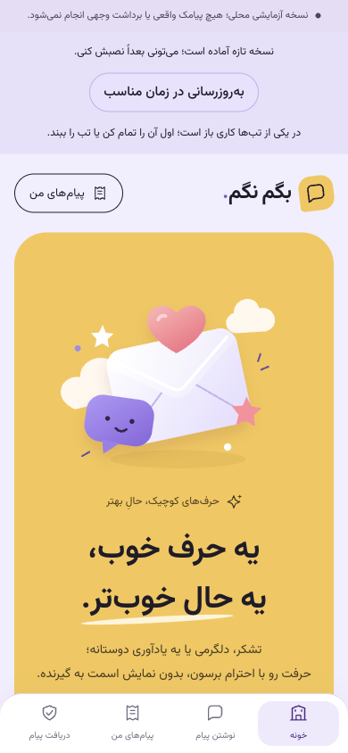
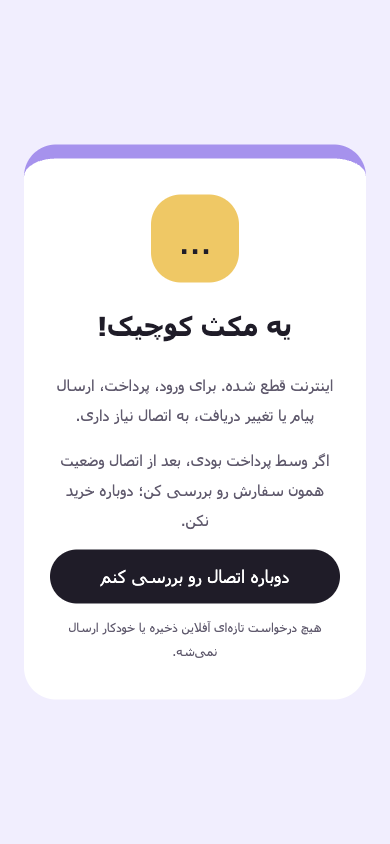

# تحویل نهایی محلی — بگم نگم۰٫۷٫۰

خروجی نرم‌افزاری فازهای۰تا۶، تا آخرین بخش قابل اجرای محلی پیش رفته است. تست‌های انسانی طبق دستور کارفرما نگه داشته شده‌اند. محیط کاربر روی [localhost:3000](http://localhost:3000) با hot reload و ظاهر فارسی Mobile-first زرد/یاسی/مرجانی باقی می‌ماند؛ image در چرخه ویرایش UI ساخته نمی‌شود. build تولیدی فقط برای اعتبارسنجی انتشار اجرا شد.

این تحویل نامزد بررسی است؛ پذیرش رسمی همه gateها یا مجوز انتشار عمومی نیست. [READINESS.json](READINESS.json) عمداً `live_ready:false` دارد: گوشی واقعی/پایلوت انسانی، کلید و پذیرش خارجی ارائه‌دهندگان، refund پس از تسویه، افراد پشتیبانی، بودجه و دامنه واقعی هنوز بازند. یک گزارش مصنوعی از تست مرورگر در محیط demo برای بررسی باقی است؛ شکایت کاربر واقعی نیست. هیچ push، استقرار بیرونی، SMS/OTP واقعی یا انتقال وجه انجام نشده است.

## خروجی هر فاز

| فاز | خروجی نرم‌افزاری/مستند | وضعیت پذیرش |
| --- | --- | --- |
| ۰ | PRD، Freeze Master نامزد، ADR، UX، API/داده، اقتصاد و۵۶نیازمندی | اسناد تاریخی محفوظ؛ امضای تجاری/انسانی جعل نشده |
| ۱ | Compose، PostgreSQL17، Redis7.4، RabbitMQ4.4، worker/beat، CI/lock و نقش‌ها | اجرای تازه و readiness محلی موفق |
| ۲ | هفت موضوع، OTP/demo، quote کامل، سفارش و پرداخت بدون تکرار، سابقه، RTL/Mobile-first و PWA | نرم‌افزار/مرورگر موفق؛ G2 به دستگاه فیزیکی نیاز دارد |
| ۳ | پروتکل کاوه‌نگار/زرین‌پال، intent/lease، verify مستقل، unknown/query-only، بودجه/refund | fixture HTTP موفق؛ G3 پذیرش خارجی ندارد |
| ۴ | stop/report بی‌حساب، audit/نقش، halt، retention/حذف/کلید، هشدار و restore | آزمون‌های محلی موفق؛ بازبینی انسانی/خارج دستگاه باز |
| ۵ | تمرین۱۲سناریو برای هفت موضوع، report، توقف/refund و کنترل پایلوت مثبت | داوطلب/ارسال واقعی اجرا نشده؛ G5 باز |
| ۶ | بار مصنوعی، تنظیم HTTPS خصوصی، readiness، تمرین rollback، ممیزی PWA و بسته شواهد | خروجی محلی تحویل؛ G6 رسمی و انتشار عمومی باز |

## نتیجه‌های ثبت‌شده

- **۸۶ تست backend** روی PostgreSQL/Redis، **۱۳ تست frontend**، typecheck و build تولیدی native/Docker موفق‌اند. پس از اصلاح نهایی اعتبارسنجی متادیتای بررسی انسانی، سه تست مربوط دوباره اجرا شدند. Compose تازه با RabbitMQ4.4.0، smoke، foundation و قفل dependency تأیید شد. [شواهد](EVIDENCE.json).
- **پایلوت مصنوعی:**۱۲سناریو، هشت capture و یک refund، هفت submission fixture؛ صفر داوطلب و صفر فراخوانی vendor خارجی. [گزارش۰٫۶](../release-v0.6/SYNTHETIC-PILOT.json).
- **بار:**۱۰۰۰حساب/۱۰نشست،۳۰جریان کامل،۱۸۰۰درخواست در۲RPS برای۱۵دقیقه +۶۰۰درخواست در۱۰RPS برای۶۰ثانیه، صفر خطای غیرمنتظره. p95 عادی۱۴۶ و جهشی۲۱۲میلی‌ثانیه؛ p95 چرخه demo حدود۴۰۰میلی‌ثانیه. منبع کد طی اجرا ثابت بود. benchmark روی میزبان مشترک و broker۴٫۲٫۹ اجرا شد؛ آزمون مستقل Compose روی۴٫۴٫۰ انجام شد. ظرفیت vendor یا۱۰۰۰کاربر هم‌زمان سنجیده نشده است. [داده اندازه‌گیری](BENCHMARK.json).
- **PWA:** دو تب کنترل‌شده، update مسدود هنگام فرم باز، حفظ draft، نصب صریح بدون reload تب دیگر، بازگشت worker اصلی، cache صرفاً چهار فایل عمومی و fallback ناشناس هنگام توقف واقعی سرور. JS اولیه فشرده۱۵۷۴۰۱بایت و کل انتقال اولیه۳۰۴۷۲۳بایت؛ این اندازه‌گیری Chromium رومیزی است، گوشی واقعی/field CWV نیست. [شاهد](PWA-BROWSER.json).
- **بازیابی:** DB تازه schema0008،۶۶فیلد رمز معتبر، صفر اختلاف مالی/منع دریافت، حفظ stop ثبت‌شده پس از snapshot و ارسال halted. restore حدود۴٫۴ثانیه؛ حذف پس از snapshot و قطع منبع اصلی در این تمرین اجرا نشده‌اند. [نتیجه](RESTORE.json).
- **بازگشت:** candidate فرانت عمداً با exit23 شکست خورد؛ همان digest سالم بازگردانده شد، health و صفحه برگشت و watermark مالی ثابت ماند. سازگاری asset چندنسخه‌ای و rollout عمومی آزموده نشده‌اند. [نتیجه](ROLLBACK.json).
- **تنظیم انتشار:** Compose مستقل با پورت عمومی فقط proxy، settings سخت‌گیرانه، Caddy validate و Django deploy check بدون اخطار. گواهی عمومی صادر نشده و template imageها نیازمند digest مصوب است. [تنظیم](RELEASE-CONFIG.json)، [runbook](RUNBOOK.fa.md).

## فایل‌های بررسی

[چک‌لیست انسانی](HUMAN-REVIEW.fa.md) و [JSON نتایج انسانی](HUMAN-CHECKS.json) تماماً NOT_TESTED/PENDING هستند. برای PASS، reviewer/date/evidence لازم است؛ ابزار هویت یا صدق امضای فرد را تصدیق نمی‌کند. [پوشش۵۶نیازمندی](TRACEABILITY.fa.md) تفکیک شاهد محلی و موارد ناقص را حفظ می‌کند. [Freeze delta](FREEZE-DELTA.fa.md) حدود نسخه را ثبت می‌کند. `REVIEW-MANIFEST.json` hash فایل‌های نهایی و کدهای مرتبط را نگه می‌دارد.

## نسخه‌ها و محدودیت تحویل

commitهای محلی:۰٫۴ `75388f0`،۰٫۵ `e0b4e59`،۰٫۶ `c0556ac`؛۰٫۷ با عنوان `feat: v0.7.0 deliver local release candidate and verification evidence` ثبت می‌شود. شناسه نهایی آن از Git قابل مشاهده است؛ قرار دادن hash همان commit داخل فایل خودش ممکن نیست. push انجام نشده است.

قیمت۲۰۰۰تومان demo، تعرفه یا قیمت نهایی نیست. مدل محلی اختیاری فقط قالب بازبینی‌شده انتخاب می‌کند؛ کیفیت مدل نصب‌شده واقعی آزموده نشده و بازنویسی آزاد/مدل ابری فعال نیست. ارسال گروهی، تبلیغات سازمانی، چت، WebSocket و اپ native به این دامنه افزوده نشده‌اند. رابط وب responsive و PWA است. قرارداد نگهداری، RPO/RTO، پشتیبانی واقعی و پذیرش حقوقی باید جدا بسته شوند.
