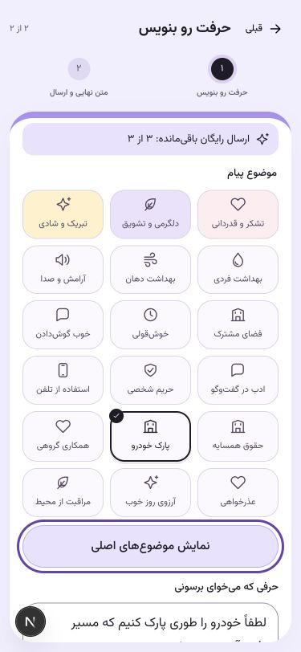

# نسخه۰٫۸٫۱۶ — لینک ساده و۱۸موضوع

خواستهٔ کارفرما: حذف نویسهٔ ویژه از کد لینک لغو پیامک و افزایش موضوع‌های ارسال. لینک تازه `begamnagam.ir/r/Ab12Cd34` است؛ کد فقط۸حرف انگلیسی/عدد تصادفی دارد. نقطه و اسلش اجزای ساختاری آدرس‌اند؛ `#` در متن پیامک تازه نیست. snapshot پیام‌های قبلی بازنویسی نمی‌شود و لینک‌های fragment۸و۴۳نویسه‌ای معتبرند.

GET/HEAD مسیر تازه، بدون lookup یا قطع دریافت، با۳۰۷ به صفحهٔ موجود `/r#<code>` می‌روند. قطع دریافت/گزارش همچنان فقط با POST و CSRF انجام می‌شود. redirect و صفحه no-store/no-referrer/noindex دارند. این تغییر، کد را در درخواست HTTP به proxy می‌رساند؛ حذف URI این مسیر از لاگ تمام لایه‌ها پیش‌نیاز انتشار است.

۱۱موضوع افزوده شد: خوش‌قولی، خوب گوش‌دادن، ادب در گفت‌وگو، حریم شخصی، استفاده از تلفن، حقوق همسایه، پارک خودرو، همکاری گروهی، عذرخواهی، آرزوی روز خوب و مراقبت از محیط. هر موضوع۲متن ملایم و۱متن صریح بررسی‌شده دارد. کنترل ورودی، انتخاب مدل از مجموعهٔ مجاز، بررسی worker و سقف۳بخش Unicode حفظ شده‌اند. فهرست از۷به۱۸موضوع رسیده؛ دکمهٔ «موضوع بیشتر» با صفحه‌کلید کار می‌کند و انتخاب جدید با بستن فهرست دیده می‌ماند.

در بررسی candidate مشخص شد پروفایل فعال سرور مقدار پیش‌فرض `PILOT_POSITIVE_ONLY=True` دارد و فقط۳موضوع مثبت را نشان می‌دهد. env آمادهٔ نسخهٔ جدید آن را صریحاً۰می‌کند تا هر۱۸موضوع در سایت مجاز قابل انتخاب باشند. تنظیم پیش‌فرض توسعه/پروفایل‌های دیگر تغییر نمی‌کند. OTP واقعی،۳هدیهٔ واقعی، پرداخت پولی بسته و بودجهٔ قبلی حفظ می‌شوند.

## بررسی

- ۱۶۳آزمون PostgreSQL/Redis در دیتابیس مجزا موفق‌اند؛ سازگاری لینک‌های قدیمی، همهٔ موضوع‌ها و هر دو لحن، محتوای ممنوع، جلوگیری از ارسال متن دستکاری‌شده و سقف طول پوشش دارند.
- ۲۵آزمون فرانت، typecheck و build انتشار موفق‌اند. redirect معتبر/نامعتبر، GET/HEAD، هدرهای خصوصی و عدم انعکاس query بررسی شده‌اند.
- UI با دادهٔ ساختگی در عرض۳۷۵و۱۴۴۰پیکسل و با صفحه‌کلید بررسی شد؛ باز/بسته‌شدن موضوع‌ها و دسترسی به مرحلهٔ بعد موفق‌اند.
- runtime لینوکس candidate، مسیر تازه۳۰۷، کد نامعتبر۴۰۴، صفحهٔ قدیمی، robots/sitemap و خانه را درست برگرداند. وابستگی native لینوکس حفظ شد.
- ۱۲سناریوی قرارداد HTTP محلی شامل ارسال/رسید، لینک تازه و گزارش بدون حساب، جلوگیری از تکرار و توقف بین پرداخت و ارسال موفق‌اند. ابزار تاریخی پایلوت نیز استخراج کد path را می‌پذیرد و حالت OTP ساختگی خود را صریحاً lookup تعیین می‌کند تا شمارش ارسال پیام با OTP عادی مخلوط نشود. این آزمون provider واقعی یا داوطلب انسانی نیست.
- مسیر OTP→پیش‌نمایش موضوع پارک→رضایت→سفارش رایگان→ارسال، روی تنظیمات candidate با transport و رزرو هزینهٔ ساختگی موفق بود؛ داده‌ها rollback شدند و پیامک واقعی ارسال نشد. کنترل واقعی بودجه در مجموعهٔ آزمون PostgreSQL پوشش دارد. رزرو روز جاری سایت هنگام بررسی۹۰٬۰۰۰از۱۰۰٬۰۰۰ریال بود؛ تغییر یا آزاد نشده است.

## وضعیت انتشار

نسخه۰٫۸٫۱۶ روی CT فعال است و هر۸سرویس سالم‌اند؛ PostgreSQL، Redis و RabbitMQ همان کانتینرهای قبلی‌اند. قبل از تغییر، نسخه/env قبلی و dump رمز‌شدهٔ DB حفظ شدند. ماندهٔ هدیه‌ها ثابت ماند:۱۰حساب با۳هدیه و۱حساب با۲هدیه؛ هیچ reset یا شارژ دوباره انجام نشد. توقف کوتاه انتشار برداشته و وضعیت ارسال قبلی بازیابی شد. بودجه۹۰٬۰۰۰از۱۰۰٬۰۰۰ریال و پرداخت پولی بسته حفظ شدند؛ ماندهٔ روز برای رزرو۲۰٬۰۰۰ریالی پیام مقصد کافی نیست.

پس از ورود SSH با رمز توسط کارفرما، config فقط همین دامنه در Nginx مرکزی بررسی و پشتیبان‌گیری شد. روی مسیر `/r/` در HTTP و HTTPS، access log بسته و error log به `/dev/null` رفت. مسیر دقیق `/r` با همان proxy/headerهای قبلی نگه داشته شد تا redirect خودکار اسلش، لینک‌های fragment را تغییر ندهد. `nginx -t` و reload موفق‌اند. آزمون HTTPS معتبر با کد ساختگی، نبودن کد در هر دو لاگ را تأیید کرد؛ درخواست کنترل `/help` همچنان در access log ثبت شد. Traefik access log ندارد و هدرهای خصوصی runtime تأیید شدند.

۳۳بررسی مسیر/asset از طریق دامنه و Nginx مرکزی با اعتبارسنجی TLS موفق‌اند؛ از جمله۳۰۷لینک تازه،۴۰۴کد نامعتبر،۲۰۰مسیر قدیمی،۱۸موضوع، SEO و CSRF. دسترسی عمومی معمول از این LAN مانند قبل Connection refused دارد؛ نتیجهٔ فوق از مسیر Nginx مرکزی با همان hostname و TLS است. تشخیص لینک روی همهٔ گوشی‌ها با تست مصنوعی اثبات نشده است. هیچ پیام واقعی تازه، پرداخت، migration یا push انجام نشده است. [شواهد استقرار](../deployments/ct115-0.8.16.json) مرجع دقیق است.

Context7 در این نشست موجود نبود؛ راهنمای همراه Next۱۶٫۴٫۳و مستندات رسمی Nginx مرجع بودند. جزئیات لاگ و بازگشت در [راهنمای عملیات](../operations.md#لینک-ساده-و-موضوعهای-بیشتر۰۸۱۶) آمده است.
