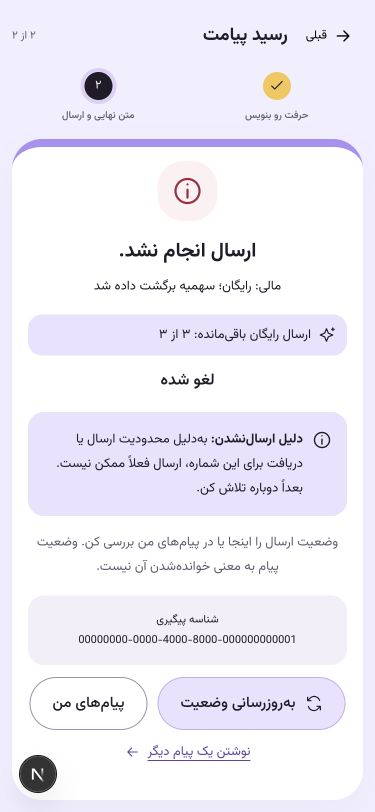

# نسخه۰٫۸٫۱۷ — توضیح علت ارسال‌نشدن

خواستهٔ کارفرما: نمایش دلیل لغو یا عدم ارسال، شامل محدودیت ارسال و دریافت؛ کمبود اعتبار و جزئیات سیستمی نمایش داده نشوند. `status_reason` عمومی به پاسخ سفارش و سابقه اضافه شد و در رسید و «پیام‌های من» نمایش داده می‌شود.

سقف درخواست‌های فرستنده، فاصلهٔ ارسال دوباره به همان شماره، شمارهٔ خود فرستنده، محدودیت حساب خودش، رد محتوا، انقضای سفارش/صف و زمان مجاز ارسال توضیح روشن و راه ادامه دارند. نتیجهٔ نامشخص، شکست معرفی نمی‌شود و از ارسال دوباره منع می‌کند. قطع دریافت، فاصلهٔ سراسری گیرنده و سفارش باز یک توضیح مشترک دارند تا اطلاعات خصوصی گیرنده افشا نشود. تاریخچه از دلیل ذخیره‌شده استفاده می‌کند؛ تغییر وضعیت فعلی گیرنده توضیح گذشته را عوض نمی‌کند.

خطای اعتبار/بودجه و دلیل فنی provider فقط توضیح عمومی عدم ارسال می‌گیرند. پیام HTTP۵xx و fields داخلی نیز عمومی می‌شوند؛ خطاهای قابل اقدام۴xx حفظ می‌شوند. کدهای عملیاتی داخلی برای بررسی اپراتور حفظ شده‌اند. موفقیت، دلیل شکست قدیمی را نشان نمی‌دهد. همان کامپوننت توضیح، با متن و علامت و role=status در رسید و سابقه استفاده می‌شود.

اعتبار هدیه، محدودیت‌ها، بودجه، پرداخت، صف و رفتار تکرار تغییر نکرده‌اند. migration لازم نیست؛ فیلد last_error_code موجود برای ثبت علت استفاده می‌شود. لینک‌های کوتاه و قدیمی و تنظیم لاگ Nginx نسخهٔ قبلی حفظ می‌شوند.

## بررسی و انتشار

نسخه۰٫۸٫۱۷ روی CT فعال و هر۸سرویس سالم‌اند. بک‌اند، worker، beat و فرانت به نسخهٔ جدید رفتند و مسیر جاری به release تازه منتقل شد. PostgreSQL، Redis و RabbitMQ همان کانتینرها هستند؛ پیش از تغییر، نسخه/env و پشتیبان رمز‌شدهٔ DB حفظ شدند. migration لازم نبود و ماندهٔ هدیه‌ها و بودجه تغییر نکردند. تنظیم Nginx این انتشار تغییر نکرد؛ محافظت مسیر خصوصی و لینک‌های نسخهٔ قبلی حفظ شدند.

۱۷۱آزمون PostgreSQL/Redis در DB مجزا،۲۶آزمون فرانت، typecheck و build انتشار موفق‌اند. آزمون‌ها۸سناریوی جدید برای علل عمومی، یکسان‌بودن خطاهای خصوصی گیرنده، عدم افشای بودجه/خطاهای داخلی، انقضا، زمان ارسال، تاریخچه و برگشت یک‌بارهٔ سهمیه دارند. بررسی سازگاری سفارش‌های قدیمیِ بدون حساب محصولی نیز موفق است؛ worker به‌جای خطای فنی به‌صورت امن متوقف و جبران را انجام می‌دهد. کد HTTP رد ارسال به خود در checkout برای سازگاری۴۰۹حفظ و توضیح آن روشن شد.

رابط تاریخچه در۳۷۵و۱۴۴۰پیکسل و مسیر کامل ساختگی تا رسید لغو در۳۷۵پیکسل بررسی شد. نقش status، متن و نماد دلیل و برگشت سهمیه دیده می‌شوند. پاسخ‌های ساختگی و viewport پس از بررسی پاک شدند. پیامک واقعی برای این آزمون ارسال نشد.

روی تنظیمات واقعی candidate، مسیر OTP→پیش‌نمایش→رضایت→سفارش رایگان→adapter با transport/رزرو هزینهٔ ساختگی و rollback داده موفق بود. ۳۳بررسی HTTPS از Nginx مرکزی، HTML/assets، مسیر لینک جدید/قدیمی، SEO، cookie و CSRF را تأیید کرد؛ اعتبارسنجی گواهی روشن بود. دسترسی معمول اینترنتی از این LAN مانند قبل محدود است؛ نتیجه از IP لبه با نام دامنه و TLS معتبر ثبت شد. جزئیات در [شواهد استقرار](../deployments/ct115-0.8.17.json) است.

Context7 در این نشست در دسترس نبود؛ این تغییر در منطق محصول و نمایش علت‌ها از APIها و الگوهای موجود مخزن استفاده می‌کند. طراحی موجود حفظ و راهنمای error recovery از مهارت UI/UX اعمال شد.
