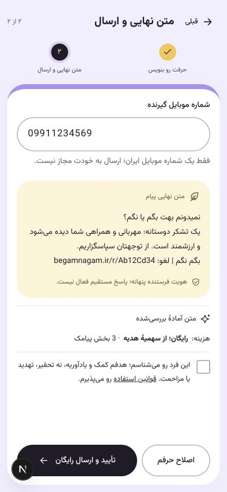

# نسخه۰٫۸٫۱۸ — جملهٔ آغاز پیامک

خواستهٔ کارفرما: اول پیام گیرنده عبارت دقیق «نمیدونم بهت بگم یا نگم؟»، سپس enter و بقیهٔ پیام قرار بگیرد. پیش‌نمایش تازه و متن واقعی snapshot این قالب را دارند:

```text
نمیدونم بهت بگم یا نگم؟
متن بررسی‌شدهٔ پیام
بگم نگم | لغو: begamnagam.ir/r/Ab12Cd34
```

جمله و newline،۲۴واحدUTF-16اضافه می‌کنند. همهٔ۱۸موضوع و هر دو لحن نمونهٔ مناسب دارند؛ اگر انتخاب بلند مدل با جمله از۲۰۱واحد عبور کند، یک نمونهٔ کامل کوتاه‌تر از همان مجموعهٔ بررسی‌شده انتخاب می‌شود و همان متن در پیش‌نمایش، سفارش و payload می‌رود. متن آزاد یا بریده ارسال نمی‌شود. حالت بدون نمونهٔ قابل‌جاسازی fail-closed است و پیش‌نمایش/grant rollback می‌شوند.

پیش‌نمایش و سفارش قبلی تغییر نمی‌کنند و worker/adapter جمله‌ای به snapshot اضافه نمی‌کند؛ retry نیز دوباره جمله را اضافه نمی‌کند. متن ثابت OTP، لینک‌ها، توضیح وضعیت، سهمیهٔ هدیه، بودجه و پرداخت پولی بسته حفظ شده‌اند. migration لازم نیست.

## بررسی و انتشار

نسخه۰٫۸٫۱۸ روی CT فعال و هر۸سرویس سالم‌اند. PostgreSQL، Redis و RabbitMQ همان کانتینرهای قبلی‌اند؛ پیش از انتشار، نسخه/env و dump رمز‌شدهٔ DB حفظ شدند. سهمیه‌ها و بودجه تغییر نکردند و توقف کوتاه انتشار به وضعیت قبلی برگشت. Nginx، تنظیم لینک خصوصی و پرداخت پولی بسته تغییر نکردند. migration و پیامک واقعی برای این تغییر لازم نشدند.

۱۷۵آزمون PostgreSQL/Redis در DB مجزا و۲۶آزمون فرانت، typecheck و build انتشار موفق‌اند. آزمون‌های جدید، جملهٔ دقیق و newline در payload، ارسال یک‌باره، انتخاب متن کامل کوتاه‌تر، رد متن بررسی‌نشده، rollback حالت بدون فضای کافی و حفظ preview قدیمی را می‌پوشانند. هر۱۸موضوع و هر دو لحن، جمله و لینک را در حداکثر۳بخش جا می‌دهند. متن ثابت OTP نیز در مجموعهٔ آزمون provider بدون تغییر تأیید می‌شود.

پیش‌نمایش با متن تولیدشده توسط formatter بک‌اند و دادهٔ ساختگی، در۳۷۵و۱۴۴۰پیکسل بررسی شد. CSS مربوط به پیش‌نمایش و متن سابقه newline را حفظ می‌کند؛ جمله روی خط جدا دیده می‌شود. پاسخ‌های ساختگی و viewport پس از بررسی پاک شدند.

بررسی پروفایل واقعی با transport و رزرو هزینهٔ ساختگی، شروع دقیق full_sms و تطابق آن با payload را تأیید کرد؛ داده‌ها rollback شدند. ۳۳بررسی HTTPS مسیر/asset از Nginx مرکزی با اعتبارسنجی گواهی موفق‌اند؛ مسیر لینک قدیمی/تازه، SEO و CSRF حفظ شدند. دسترسی عادی اینترنتی از این LAN مانند قبل محدود است و نتیجهٔ فوق از IP لبه با نام دامنه و TLS معتبر به‌دست آمد. [شواهد استقرار](../deployments/ct115-0.8.18.json) جزئیات را دارد.


