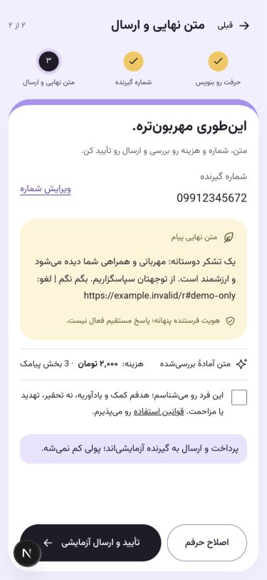
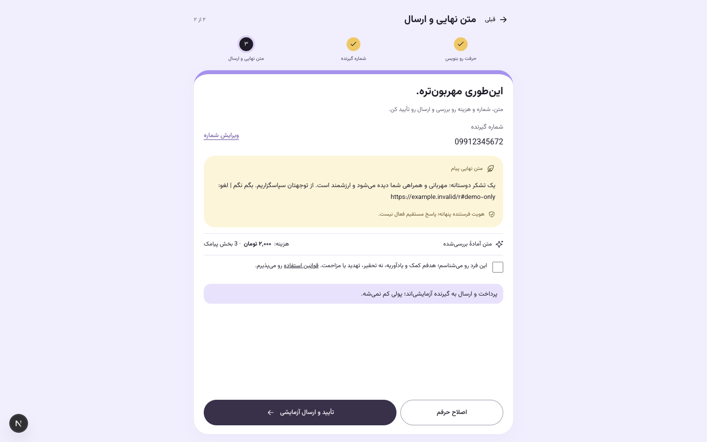

# اصلاح رابط۰٫۸٫۵

سه نظر مرورگر اعمال شد: نشان تأیید فرستنده در فرم گیرنده حذف شد؛ شماره‌های ورود/گیرنده و OTP هنگام تغییر، ارقام فارسی و عربی را به انگلیسی تبدیل می‌کنند؛ متن نهایی و تأیید/ارسال در یک مرحله ادغام شدند.

فرم سه مرحله دارد: نوشتن، شمارهٔ گیرنده، متن نهایی و ارسال. مرحلهٔ آخر متن کامل بررسی‌شده، شمارهٔ گیرنده، هزینه/تعداد بخش، پذیرش قوانین و دکمهٔ ارسال را کنار هم نشان می‌دهد. تا پیش از ساخت سفارش می‌توان متن یا شماره را ویرایش کرد؛ پیش‌نمایش تازه، تأیید قوانین تازه می‌خواهد. پس از ثبت سفارش، ویرایش قفل و پرداخت همان سفارش در تلاش بعدی ادامه داده می‌شود.

۱۴ تست فرانت و typecheck موفق‌اند. در مرورگر، درخواست اول پرداخت آزمایشی یک بار عمداً قطع شد؛ تلاش دوم همان سفارش را ادامه داد. فقط یک سفارش، یک ثبت مالی و یک outbox ساخته شد و وضعیت `delivered_demo` ثبت شد. برای این بررسی هیچ OTP یا پیام واقعی ارسال نشد؛ مسیر واقعی OTP موجود تغییر نکرد.

در ورودی‌ها ترکیب ارقام فارسی/عربی بررسی شد؛ کد نمونهٔ دارای صفر ابتدایی به `001234` تبدیل شد. تست ورود با پاسخ HTTP مصنوعی و شمارهٔ نمونه انجام شد و هیچ شماره‌ای به سرویس‌دهنده فرستاده نشد. متن آزاد پیام و شناسه‌ها با تبدیل عمومی JSON بازنویسی نمی‌شوند.

[نتایج ساختاری](UI-CHECKS.json) اندازه‌های۳۷۵×۸۱۲،۳۷۵×۶۶۷ و۱۴۴۰×۹۰۰ را ثبت می‌کند. اسکرول کل صفحه در موبایل بسته است؛ در نمای کوتاه، پنل برای رسیدن به دکمه و خواندن کل متن اسکرول داخلی دارد. دسکتاپ فوتر و اسکرول معمول خود را حفظ می‌کند. بررسی روی دستگاه فیزیکی در این تغییر انجام نشده است.

تصاویر زیر دادهٔ کاملاً مصنوعی و لینک `example.invalid` دارند؛ هیچ شمارهٔ واقعی، کد ورود واقعی یا قابلیت فعال توقف دریافت در آن‌ها نیست. مسیر کامل ارسال آزمایشی پیش از ثبت این تصاویر، با API و پایگاه واقعی محلی بررسی شد.

همهٔ اصلاحات با Fast Refresh و همان dev server انجام شدند؛ image ساخته نشد. تنظیمات خصوصی `.env` خارج از Git باقی ماندند. نسخه با کامیت محلی ثبت می‌شود و push مجاز نیست.
