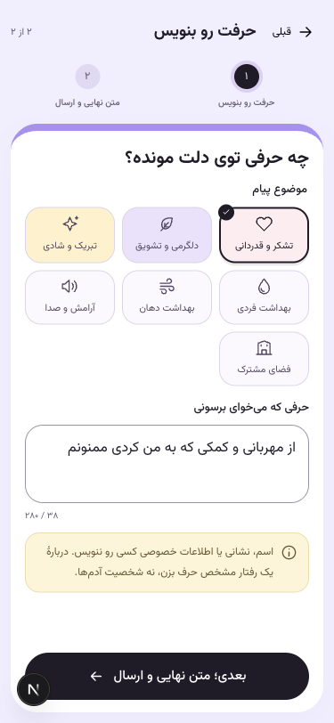
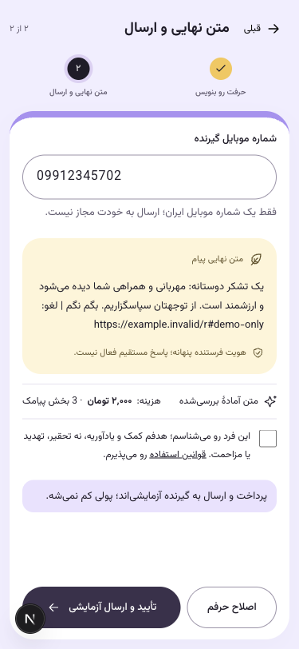
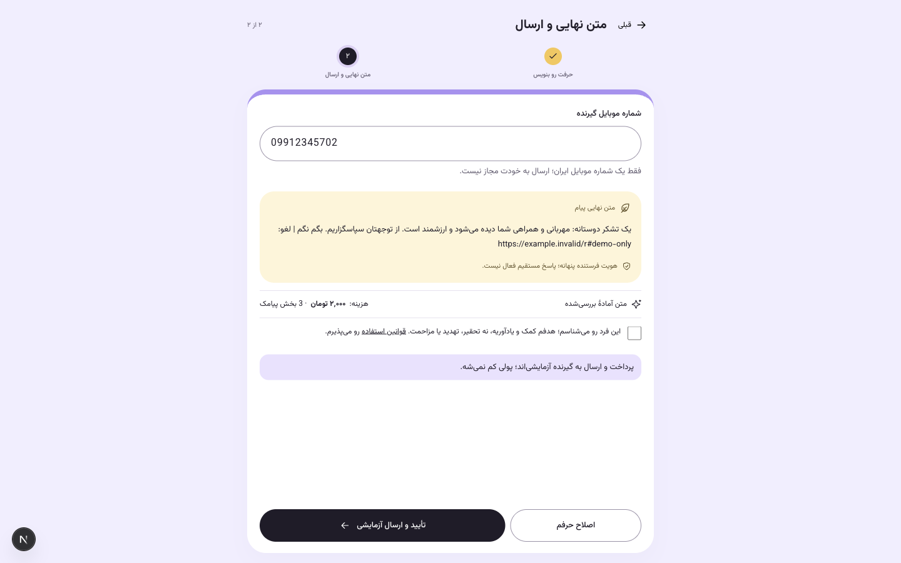

# اصلاح رابط۰٫۸٫۶

نوار توضیح انتخاب از متن‌های آماده حذف شد. نکتهٔ حریم خصوصی و نوشتن دربارهٔ رفتار، در یک هشدار زرد زیر کادر متن قرار دارد؛ شمارندهٔ کاراکتر در محل قبلی باقی مانده است. هشدار ثابت با `role=note` و `aria-describedby` به کادر وصل است تا هنگام تایپ اعلان مزاحم ایجاد نکند.

فرم اکنون دو صفحه دارد: نوشتن، سپس گیرنده و متن نهایی/ارسال. شماره در صفحهٔ نهایی وارد می‌شود؛ «آماده‌سازی متن» پیش‌نمایش متصل به همان شماره را می‌سازد و صفحه عوض نمی‌شود. توضیح «قبل از ارسال، متن نهایی و هزینه رو می‌بینی» نیز همراه مرحلهٔ مستقل گیرنده حذف شد.

تغییر شمارهٔ یکسان‌سازی‌شده، پیش‌نمایش و رضایت قبلی را پاک می‌کند. شماره باید دوباره بررسی، متن تازه دیده و قوانین دوباره تأیید شوند. پس از ساخت سفارش شماره فقط خواندنی است و همان سفارش به پرداخت ادامه می‌دهد. کنترل‌های احراز هویت و اتصال قیمت/متن/شماره در بک‌اند تغییر نکردند.

۱۴ تست فرانت و typecheck موفق‌اند. در تست مرورگر، شمارهٔ نامعتبر مسدود شد؛ تغییر شماره بعد از تأیید، متن و رضایت را پاک کرد؛ سفارش با شناسهٔ پیش‌نمایش تازه ساخته و شماره قفل شد؛ سپس همان سفارش به رسید رفت. پاسخ‌های پیش‌نمایش/سفارش/پرداخت در این بررسی مصنوعی‌اند؛ هیچ پیامک یا پرداخت واقعی و هیچ سفارش تازه در پایگاه ایجاد نشد.

[نتایج بررسی](UI-CHECKS.json) نمای۳۷۵×۸۱۲ و۱۴۴۰×۹۰۰ را ثبت می‌کند. در موبایل، فرم نمونه در پنل جا گرفت و کل صفحه اسکرول نداشت. تصاویر از رندر واقعی رابط با متن، شماره و لینک نمونهٔ `example.invalid` گرفته شده‌اند و قابلیت فعال توقف دریافت ندارند.

همان dev server با Fast Refresh روشن ماند؛ image ساخته نشد. تست گوشی فیزیکی در این تغییر انجام نشده است. نسخه با کامیت محلی ثبت می‌شود؛ push انجام نمی‌شود.
