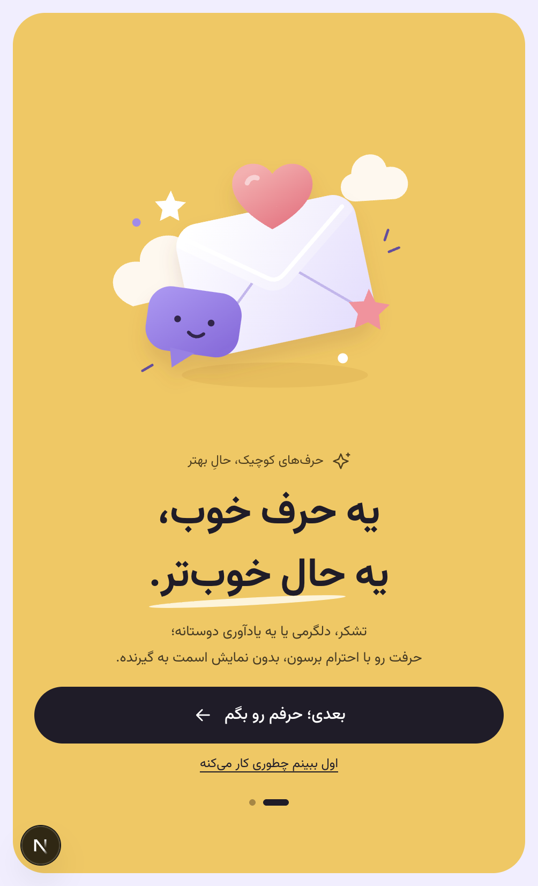
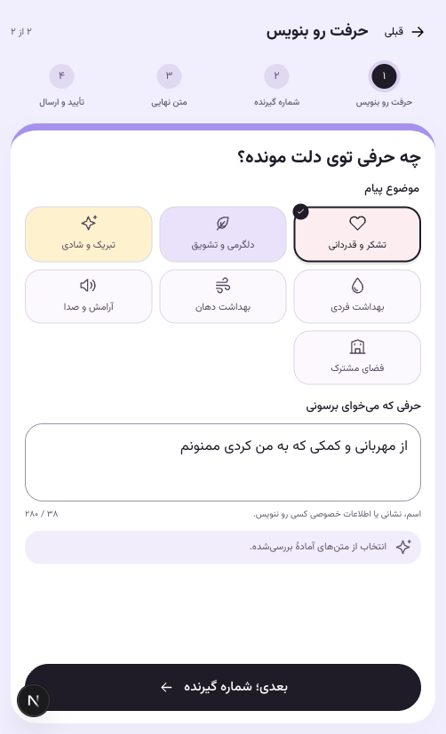

# رابط۰٫۸ — اصلاح هفت نظر مرورگر

تمام تغییرها روی dev server فعال با hot reload اعمال شدند. پورت۳۰۰۰ و پردازش توسعه حفظ شد؛ Docker image یا build تولیدی برای ویرایش UI ساخته نشد. commit محلی ثبت می‌شود و push انجام نمی‌شود.

| نظر | نتیجه |
| --- | --- |
| ۱ | نوار «نسخه آزمایشی محلی» از layout حذف شد؛ OTP، پرداخت و رسید همچنان آزمایشی‌بودن را روشن می‌کنند. |
| ۲ | هدر لوگو/پیام‌های من در صفحهٔ خانه نمایش داده نمی‌شود. |
| ۳ | معرفی یک اسلاید تمام‌صفحه با دکمهٔ بعدی است؛ صفحهٔ اصلی موبایل به پایین اسکرول نمی‌شود. |
| ۴ | نوار سه اصل از خانه حذف شد. |
| ۵ | Composer در اسلاید دوم است؛ نوشتن، شماره‌ها، پیش‌نمایش و تأیید در صفحه‌های داخلی مستقل جا می‌شوند. |
| ۶ | فوتر در عرض کمتر از۷۰۰پیکسل مخفی است؛ فوتر دسکتاپ باقی است. |
| ۷ | انتخاب هر موضوع، متن مثال همان موضوع را مستقیم در textarea می‌گذارد؛ دکمهٔ مثال حذف شد و متن قابل ویرایش است. |

ورود به فرم همچنان به تأیید شماره خود فرستنده نیاز دارد. تأیید قبل از نوشتن انجام می‌شود تا پاک‌سازی امن نشست در ورود/تعویض حساب، پیش‌نویس تازه را از بین نبرد. لینک `/#compose` مستقیم اسلاید دوم را باز می‌کند؛ مرورگر Back و دکمه قبلی پشتیبانی می‌شوند. صفحات راهنما/سابقه/تنظیمات اسکرول عادی و ناوبری خود را دارند.

در شش قاب۳۲۰×۵۶۸،۳۶۰×۶۴۰،۳۷۵×۶۶۷،۳۹۰×۸۴۴،۴۱۲×۹۱۵ و۵۰۲×۸۲۷، معرفی و فرم نوشتن بدون overflow افقی/عمودی سند یا نیاز به اسکرول پنل جا شدند. در ارتفاع خیلی کم، کیبورد، landscape یا zoom، خود پنل فرم امکان overflow محدود دارد تا کنترل‌ها پنهان نشوند؛ سند اصلی موبایل ثابت می‌ماند. visual viewport و safe area رعایت و pinch zoom محدود نشده است.

۱۳ تست frontend و typecheck موفق؛ آزمون مرورگر شامل انتخاب مستقیم هر هفت موضوع، خطای متن/شماره خالی، حفظ draft با قبلی و Back مرورگر، ورود OTP مصنوعی، quote، رضایت، پرداخت demo و رسید شبیه‌سازی‌شده است. کاهش حرکت و ثابت‌ماندن `performance.timeOrigin` در تغییرهای hot reload تأیید شدند. شواهد عددی در [UI-CHECKS.json](UI-CHECKS.json) هستند. تصاویر فاقد شماره، OTP یا لینک capability واقعی‌اند.

این‌ها آزمون خودکار Chromium رومیزی با اندازهٔ موبایل‌اند. تست انسان، کیبورد و gesture دستگاه واقعی، ماتریس Android/iOS و پذیرش خارجی همچنان در [چک‌لیست۰٫۷](../release-v0.7/HUMAN-REVIEW.fa.md) نگه داشته شده‌اند. پوشش PWA production بستهٔ۰٫۷ تاریخی است؛ در این نوبت تغییر SW یا ادعای پذیرش production تازه وجود ندارد.
