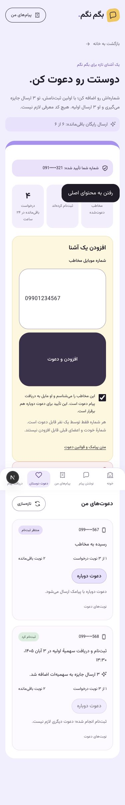

# نسخه۰٫۹٫۰ — دعوت با شماره و جایزهٔ ثبت‌نام

پنل خصوصی `/invitations` از خانه، منو و نوار موبایل در دسترس است. کاربر شمارهٔ آشنای مایل به دریافت دعوت را اضافه می‌کند؛ پیام ثابت بررسی‌شده با جملهٔ آغاز و لینک لغو۸حرف/عدد ارسال می‌شود. نام یا شمارهٔ دعوت‌کننده در پیام نیست. کد معرف، ورودی متن دلخواه و لینک حاوی شناسهٔ دعوت وجود ندارند.

طبق انتخاب صریح کارفرما، اولین ساخت حساب با OTP شمارهٔ دعوت‌شده پس از ثبت دعوت،۳ارسال به دعوت‌کننده جایزه می‌دهد. دعوت‌شده همان۳هدیهٔ اولیه را دارد. ثبت‌نام از هر مسیر سایت پذیرفته است؛ درخواست OTP به‌تنهایی جایزه ندارد. ورود مجدد و retry پردازشگر جایزه را تکرار نمی‌کنند. جایزه و افزایش سهمیه در یک تراکنش ثبت می‌شوند؛ beat ثبت جایزهٔ جاافتاده پس از crash را ترمیم می‌کند. شمارندهٔ سهمیهٔ حساب، هدیهٔ اولیه و جایزه‌های کسب‌شده را پوشش می‌دهد؛ حساب‌های قبلی reset نمی‌شوند.

هر شماره در کل سایت فقط یک دعوت‌کننده دارد. شمارهٔ خود، اعضای قبلی و شمارهٔ دعوت‌شده توسط دیگری پذیرفته نمی‌شوند. اعلام عضویت قبلی، استثنای صریح خواسته‌شده فقط در پنل دعوتِ احرازشده است؛ ارسال عادی، قطع دریافت و هویت دعوت‌کنندهٔ دیگر همچنان افشا نمی‌شوند. یکتایی دیتابیس و قفل مشترک شماره، رقابت دو دعوت‌کننده و رقابت دعوت/ثبت‌نام را کنترل می‌کنند.

حداکثر۳درخواست برای هر مخاطب با فاصلهٔ۲۴ساعت،۵درخواست در۲۴ساعت برای دعوت‌کننده،۳۰روز فرصت درخواست مجدد و۴۸ساعت حداکثر ماندن درخواست ارسال‌نشده در صف برقرارند. شکست قطعی نیز یک نوبت درخواست است؛ صف، timeout و وضعیت نامعلوم نوبت تازه ایجاد نمی‌کنند. هیچ timeout یا نبود رکورد provider مجوز ارسال مجدد نیست. وضعیت ثبت‌نام، تحویل پیامک، تعداد نوبت، زمان دعوت‌ها و جایزه جدا نمایش داده می‌شوند. دعوت از سهمیهٔ پیام حساب کم نمی‌کند؛ هزینهٔ provider از همان سقف مشترک قبلی رزرو می‌شود و سقف افزایش نمی‌یابد. پرداخت پولی بسته می‌ماند.

شمارهٔ دعوت رمز‌شده و برای تطبیق HMAC است؛ snapshot پیام و capability نیز رمز می‌شوند. CSRF، تأیید آشنایی/تمایل دریافت با نسخه و زمان، محدودیت lookup ناموفق، مالکیت فهرست، توقف دریافت، تعلیق و زمان مجاز ارسال برقرارند. شماره و snapshot تعیین‌تکلیف‌شده پس از۹۰روز پاک می‌شوند؛ claim حداقلی و سابقهٔ جایزه باقی می‌مانند. پروندهٔ دارای hold و نتیجهٔ نامعلوم پاک‌سازی نمی‌شوند. پنل `no-store` و `noindex` است و وارد sitemap نمی‌شود.

## استقرار و بازگشت

Migrationهای۰۰۱۳و۰۰۱۴ جدول‌های دعوت/outbox، مبدأ جدید grant و شمارندهٔ جایزه را اضافه می‌کنند. migration داده‌های حساب قبلی را reset نمی‌کند؛ constraint سهمیه از حداکثر۳ به حداکثر۳به‌اضافهٔ مجموع جایزه‌های ثبت‌شده تغییر می‌کند. پیش از انتشار dump رمز‌شده گرفته می‌شود و dispatch موقتاً متوقف می‌ماند. DB، Redis، RabbitMQ، کلیدها، تنظیم Nginx و بودجه حفظ می‌شوند.

برای rollback نرم‌افزار به۰٫۸٫۱۸، schema افزوده را حفظ کنید؛ migration معکوس پس از کسب جایزه یا تولید لینک دعوت امن نیست. پیش از بازگشت، دعوت‌های pending/submitting/unknown را بررسی و ارسال دعوت تازه را ببندید. لینک `/r/` در فرانت قدیم کار می‌کند؛ bootstrap قدیم مجموع جایزه را نشان نمی‌دهد، ولی مانده در DB حفظ می‌شود. نتیجهٔ نامعلوم را بازپخش نکنید. بازگرداندن dump، جایگزین رسیدگی به پیامک واقعیِ پس از backup نیست.

## بررسی

آزمون‌های خودکار از transport ساختگی و DB مجزا استفاده می‌کنند؛ هیچ پیامک واقعی برای بررسی این نسخه فرستاده نمی‌شود. رابط در۱۴۴۰و۳۷۵پیکسل با دادهٔ ساختگی، شامل اعلان عضو قبلی و نمایش ثبت جایزه بررسی شد. پاسخ ساختگی و viewport پس از بررسی پاک شدند. ۲۰۷آزمون PostgreSQL/Redis با سه سناریوی هم‌زمانی دعوت و۲۸آزمون فرانت، typecheck و build انتشار موفق‌اند. آزمون پروفایل واقعی در DB مجزا، با transport و رزرو هزینهٔ ساختگی، OTP، payload ثابت دعوت و ثبت جایزه یک‌بار را تأیید کرد. یک فرض قدیمیِ آزمون مبنی بر وجود تنها یک RecipientState به انتخاب صریح گیرنده اصلاح شد؛ رفتار خطای خصوصی ارسال عادی تغییر نکرد. نسخه۰٫۹٫۰ روی CT فعال و هر۸سرویس سالم‌اند؛ هر۳سرویس داده بدون recreate حفظ شدند. migrationها پس از dump رمز‌شده اعمال شدند، ماندهٔ حساب‌ها تغییر نکرد و توقف انتشار به حالت قبلی برگشت. ۳۵بررسی HTTPS مسیر/asset با TLS معتبر موفق‌اند؛ پنل دعوت no-store/noindex و API بدون نشست۴۰۱ است. سقف روزانهٔ فعلی۱۰۰٬۰۰۰ریال در زمان انتشار پر بود و افزایش نیافت؛ دعوت تازه تا بازهٔ مجاز روز بعد در صف می‌ماند و OTP واقعی نیز تا دسترس‌پذیرشدن بودجه محدود است. بررسی این نسخه از IP لبه با نام دامنهٔ معتبر انجام شد؛ مسیر عادی اینترنتی از این LAN در این انتشار تأیید نشد. [شواهد استقرار](../deployments/ct115-0.9.0.json) جزئیات را دارد.

Context7 در این محیط ابزار قابل‌فراخوانی نداشت. مرجع تراکنش و قفل، [مستندات رسمی Django](https://docs.djangoproject.com/en/5.2/ref/models/querysets/#select-for-update) و [on_commit](https://docs.djangoproject.com/en/5.2/topics/db/transactions/#performing-actions-after-commit) بود؛ مسیر و Link با مستندات همراه Next.js۱۶٫۴٫۳ بررسی شدند.

