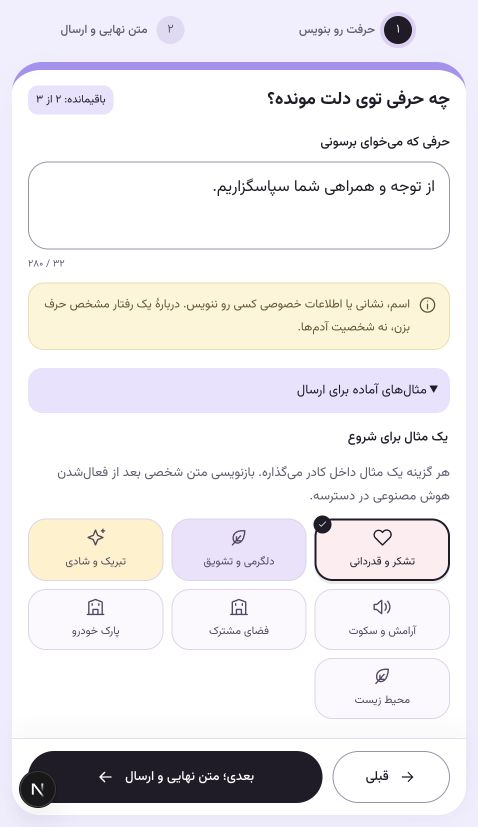
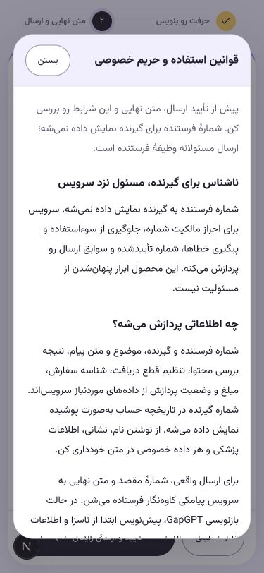

# فرم جمع‌وجور و پنجرهٔ قوانین — نسخه۰٫۱۰٫۲

این تغییر مطابق هفت یادداشت مرورگر انجام شد و سپس با دستور صریح کارفرما در نسخه۰٫۱۰٫۲ روی سرور منتشر شد. تنظیم OTP، ارسال واقعی، هدیه و درگاه تغییر نکرده است. [گزارش انتشار](../release-v0.10.2/README.fa.md) وضعیت محصول واقعی را ثبت می‌کند.

- جملهٔ «کد ورود با پیامک واقعی می‌رسد.» از فرم ورود حذف شد.
- نوار بالای فرم حذف شد؛ عنوان برای صفحه‌خوان حفظ است. «قبلی» با عرض کمتر و حاشیهٔ مشخص کنار دکمهٔ اصلی در پایین صفحه ثابت است؛ این ردیف در ورود، نوشتن، مرور و رسید نیز قابل دسترسی است.
- شمارهٔ مراحل کنار عنوان مراحل است. مانده با «باقیمانده: ۲ از ۳» کنار عنوان نوشتن قرار دارد؛ مقدار واقعی هدیه و پاداش‌ها همچنان از API می‌آید.
- کادر توضیح غیرفعال‌بودن بازنویسی و راهنمای زیر شمارهٔ گیرنده حذف شدند. اعتبارسنجی متن/شماره و خطاهای عملیاتی حفظ‌اند.
- «قوانین استفاده» پنجرهٔ native باز می‌کند؛ متن با صفحهٔ حریم خصوصی مشترک و بدون تغییر حقوقی است. بازکردن آن checkbox را تغییر نمی‌دهد؛ Escape، کلیک بیرون، بستن و بازگشت فوکوس کار می‌کنند.

۳۱آزمون فرانت و typecheck موفق‌اند. بررسی جداگانهٔ رابط در عرض‌های۳۷۵،۴۷۸و۱۴۴۰ و ارتفاع کوتاه۵۰۰پیکسل انجام شد؛ سرریز افقی نبود و فوکوس و متن تأیید زیر ردیف ثابت پنهان نشدند. کیبورد نرم‌افزاری گوشی واقعی در این بررسی استفاده نشده است؛ listener مربوط به visualViewport فاصلهٔ آن را محاسبه می‌کند. بازگشت به نوشتن متن را حفظ می‌کند؛ درخواست/تأیید OTP در حالت busy دکمهٔ قبلی را می‌بندد.

تصاویر زیر صرفاً بررسی ظاهریِ جدا با دادهٔ نمایشی‌اند. فقط bootstrap و پیش‌نمایش پاسخ محلی داشتند؛ هیچ درخواست OTP، ثبت سفارش، ارسال واقعی یا ارسال شبیه‌سازی‌شده انجام نشد. تمام مسیرهای ارسال در آن تب مسدود بودند؛ تب بررسی، دادهٔ نمایشی و تغییر اندازه پس از بررسی پاک شدند. تب محصول واقعی دست‌نخورده باقی ماند.

Context7 این نشست ابزار قابل‌فراخوانی نداشت؛ راهنمای رسمی نصب‌شدهٔ Next.js برای Client Components و Fast Refresh، [React createPortal](https://react.dev/reference/react-dom/createPortal) و [dialog](https://developer.mozilla.org/en-US/docs/Web/HTML/Element/dialog) مبنای پیاده‌سازی بودند.

## اصلاح محلی فرم نوشتن — dev، ۲۰۲۶-۱۰-۲۹

عنوان تکراری «حرفی که می‌خوای برسونی» از نمایش حذف شد؛ نام قابل دسترس کادر
از عنوان اصلی فرم می‌آید. راهنمای حریم خصوصی با همان متن، به‌صورت helper ساده
درست زیر textarea و کنار شمارنده قرار دارد و همچنان با `aria-describedby`
به کادر متصل است؛ بنر قبلی و فاصلهٔ آن بعد از انتخاب لحن حذف شدند.

هدر جمع‌شونده و دکمهٔ مثال‌های بیشتر/کمتر حذف شدند؛ همهٔ مثال‌های فعال API
از ابتدا در همان شبکهٔ باکس‌ها قرار می‌گیرند. در دادهٔ فعلی، ۷ گزینهٔ اولیه و
۱۱ گزینهٔ پنهان، یعنی مجموع ۱۸ گزینه، هم‌زمان ارائه می‌شوند. تعداد در رابط
ثابت نشده است؛ فیلتر و فهرست فعال سرور حفظ می‌شوند. انتخاب گزینه همچنان فقط
متن نمونه را در کادر می‌گذارد و درخواست بازنویسی یا ارسال ایجاد نمی‌کند.

۷۶ تست فرانت، TypeScript و ۳۴ بررسی مرورگر در عرض‌های ۳۲۰، ۳۷۵، ۴۷۷ و ۱۴۴۰
موفق بودند. لایت/دارک، نبود سرریز، ناحیهٔ لمس، انتخاب آخرین مثال، کار با Space،
نام و helper قابل دسترس و حفظ متن در رفت‌وبرگشت مراحل بررسی شدند. دادهٔ آزمون
در context مستقل بود؛ پیامک، پرداخت یا تماس AI انجام نشد. این اصلاح با Fast
Refresh در همان سرور UI بومی اعمال شد و انتشار روی سرور نیست.

## اصلاح یادداشت‌های رابط — توسعهٔ محلی

ناوبری در فرم نوشتن هم نمایش داده می‌شود؛ دکمه‌های ثابت روی آن نمی‌افتند.
عنوان لحن پیش از گزینه‌ها در همان ردیف است و legend قابل دسترس حفظ شده است.
دسته‌ها یک ردیف با اسکرول افقی بومی و scroll snap، فلش‌های قابل دسترس و
راهنمای کشیدن دارند؛ انتخاب دسته پیش‌نویس را پاک نمی‌کند. دکمهٔ مرحلهٔ بعد
به رنگ ثابت نارنجی برند است و در هر دو تم خوانایی دارد.

صفحهٔ اول برای حساب واردشده دکمهٔ خروج ۴۴ پیکسلی در پایین راست دارد؛ ورود
متحرک، حالت انتظار، خطای قابل اصلاح و کاهش حرکت رعایت می‌شوند. خروج همان
API دارای CSRF و پاک‌سازی نشست سایر تب‌ها را استفاده می‌کند. نام روش پرداخت
در متن‌های عمومی به «درگاه بانکی» یکسان شده است؛ شناسه‌ها و اتصال درگاه تغییر
نکرده‌اند. آزمون مرورگر در context مستقل انجام می‌شود و هیچ پیامک، پرداخت یا
بازنویسی پولی برای بررسی رابط ارسال نمی‌شود.

Context7 در این نشست قابل فراخوانی نبود؛ راهنمای Next نصب‌شده و مستندات رسمی
[اشتراک وضعیت مرورگر در React](https://react.dev/reference/react/useSyncExternalStore)،
[scroll snap](https://developer.mozilla.org/en-US/docs/Web/CSS/Reference/Properties/scroll-snap-type)
و [scrollBy](https://developer.mozilla.org/en-US/docs/Web/API/Element/scrollBy)
مبنای پیاده‌سازی بودند.

در نوار اقدام، pointerdown هنگام ویرایش ورودی، فوکوس را تا اجرای click حفظ
می‌کند تا ظاهرشدن ناوبری جای دکمه را وسط لمس عوض نکند. درخواست و تأیید OTP
و رفتن از پیش‌نویس به گیرنده با یک کلیک در مرورگر جدا بررسی شدند؛ در مرحلهٔ
کد، منوی موبایل نیز نمایان می‌ماند (طبق اصلاح ۲۰۲۶-۱۰-۳۰). این بررسی با پاسخ‌های ساختگی فقط
در context آزمون بود و هیچ کد واقعی درخواست نشد.

۷۶ تست فرانت، TypeScript و ۷۳ نتیجهٔ بررسی رابط در عرض‌های ۳۲۰، ۳۷۵، ۴۷۷،
۷۰۰، ۸۱۲ افقی و ۱۴۴۰ موفق بودند. کشیدن بومی با لمس، انتخاب با صفحه‌کلید،
مبدأ تازهٔ تغییر تم، بازگشت مرورگر، خروج موفق و تلاش دوباره پس از خطا نیز
بررسی شدند. سرور UI بومی در تمام ویرایش‌ها روشن ماند؛ انتشار سرور انجام نشد.

نوار نمایشی مراحل از فرم حذف شد؛ عنوان مرحله برای دسترس‌پذیری و فوکوس باقی
است. فلش‌های دسته‌ها اکنون قاب دیداری ۳۰ پیکسل با آیکون ۱۵ پیکسل و ناحیهٔ
لمس ۴۴ پیکسل دارند. خروج صفحهٔ اول قرمز با آیکون سفید است. دکمهٔ تم صفحهٔ
اول با ورود ۶۵۰ میلی‌ثانیه‌ای و تأخیر ۱۲۰ میلی‌ثانیه ظاهر می‌شود؛ بازگشت از
فرم آن را دوباره اجرا می‌کند و کاهش حرکت آن را فوری نشان می‌دهد.

در اصلاح ۲۰۲۶-۱۰-۳۰، پنهان‌کردن منو با فوکوس حذف شد؛ منو و ردیف اقدام
از inset کیبورد استفاده می‌کنند. لبه‌های ردیف دسته‌ها با mask و گرادیانت رنگ
surface زیر فلش‌های overlay محو می‌شوند؛ در لایت سفید و در دارک رنگ کارت‌اند.
متن کوتاه بالای تیتر خانه حذف و پشتیبانی ۴۴ پیکسلی با اندازه‌گیری قاب اصلی در
پایین چپ آن، هم‌ردیف خروج قرار می‌گیرد؛ در صفحات دیگر فاصله از موانع حفظ است.

نسخهٔ نرم‌افزار با اندازهٔ ۹ پیکسل در خط ۱۲ پیکسلی زیر اپلیکیشن/ناوبری، بالای
safe area نمایش داده می‌شود. منبع آن package.json است؛ شمارهٔ عقب‌ماندهٔ بسته
با انتشار ثبت‌شدهٔ۰٫۱۳٫۰هماهنگ شد و اجرای بومی development برچسب «توسعه» دارد.
فضای این خط از کنترل‌ها جداست و ارقام با قلم مشترک فارسی نمایش داده می‌شوند.
تغییرات محلی همچنان در بخش Unreleased از CHANGELOG.md ثبت هستند.

در فرم نوشتن، محتوای ورود شماره و OTP مستقیماً داخل compose-panel قرار دارد؛
کادر auth-card میانی حذف شده است. فرم native، label/helper، ورودی واحد OTP،
تأیید خودکار و نوار اقدام همان رفتار را دارند؛ ورود مستقل در صفحات حساب همچنان
قاب خود را دارد.

دکمهٔ تأیید نهایی با [انیمیشن Paper Dart](../send-button-motion.fa.md) به کاغذ
تاخورده تبدیل می‌شود و پرواز می‌کند. تأیید ثبت و انتقال به رسید پس از نتیجهٔ
واقعی سفارش و پایان حرکت انجام می‌شوند؛ پاسخ کند، خطا و تلاش دوباره نیز
حالت مستقل دارند.
